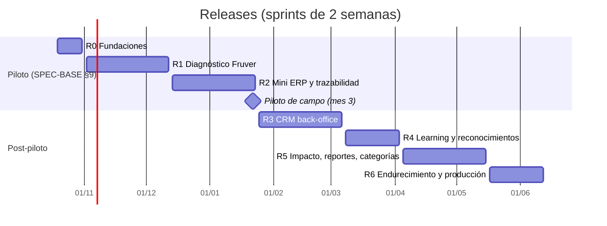
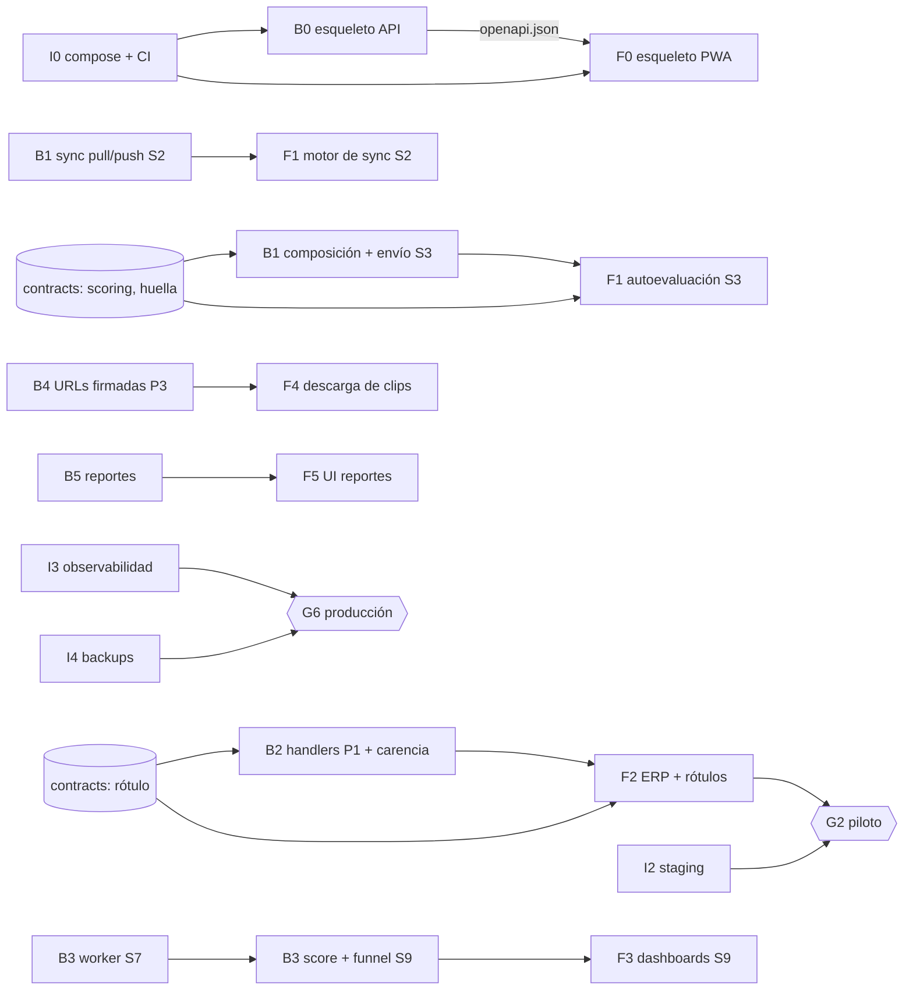

# Plan maestro — Academia de Proveedores Smile

**Versión 1.0 · 15 de octubre de 2026** · Horizonte: 19/10/2026 – 11/06/2027 (17 sprints de 2 semanas)

> **Modo POC activo:** el alcance, la profundidad de pruebas y las reglas de ahorro de tokens se rigen por [`MODO_POC.md`](MODO_POC.md), que prevalece sobre este plan. Prioridad 1: datos de demostración y usuarios precreados (MODO_POC §3).

Este documento coordina los tres planes de ejecución. No repite su detalle: dice **qué se entrega cuándo, en qué orden y con qué criterio se da por terminado**.

| Plan | Alcance |
|---|---|
| [PLAN_FRONTEND](PLAN_FRONTEND.md) | PWA `/app` local-first, back-office `/smile`, landing, sistema de diseño (fases F0–F6) |
| [PLAN_BACKEND](PLAN_BACKEND.md) | API FastAPI, monolito modular hexagonal, sync, worker (fases B0–B6) |
| [PLAN_INFRA](PLAN_INFRA.md) | Docker multistage, Compose, CI/CD, entornos, observabilidad, backups (fases I0–I7) |

## 1. Principios de ejecución

1. **Specs como fuente de verdad.** Todo trabajo traza a `docs/specs/` mediante RF → CU → HU. Si algo no tiene fuente, se registra como S-xx o Q-xx en [`conflictos-y-supuestos.md`](../sistema/conflictos-y-supuestos.md) antes de construirlo.
2. **Documentar primero.** Un cambio de regla, contrato o pantalla actualiza primero su documento (requerimientos, arquitectura, GUIA_VISUAL) y después el código, en el mismo PR.
3. **Rebanadas verticales.** Cada release es usable de punta a punta por un proveedor real; no hay releases "solo backend".
4. **Offline no es una fase.** Desde R1 todo flujo de `/app` se prueba en modo avión.
5. **Contratos antes que integración.** OpenAPI y fixtures de `contracts/` se acuerdan al inicio del sprint; frontend y backend trabajan en paralelo contra ellos.

## 2. Línea de tiempo

**Correspondencia con la hoja de ruta del spec [SPEC-BASE §9]:** Mes 1 (base PWA, WatermelonDB, UI Quiet Luxury) = S0–S1 · Mes 2 (backend FastAPI y motor de cuestionarios) = S2–S3 · Mes 3 (pruebas de campo y despliegue piloto) = S4–S6. R3–R6 amplían el alcance al CRM completo y a producción.

## 3. Calendario de sprints

Puntos y asignación de [`historias-de-usuario.md`](../sistema/historias-de-usuario.md) §10. Capacidad objetivo 25–35 pts por sprint.

| Sprint | Fechas | Release | Objetivo del sprint | Historias | Pts |
|---|---|---|---|---|---|
| **S0** | 19/10 – 30/10/2026 | R0 | `make up` levanta todo; CI verde; tokens y fuentes | HU-PLAT-01…06, HU-DS-01, 02, 04 | 34 |
| **S1** | 02/11 – 13/11 | R1 | Registro, ingreso, consentimiento, base local, primitivos | HU-DS-03, HU-IAM-01…03, HU-PRV-01, HU-SYN-01, HU-CAT-01, HU-CAL-02, HU-NOT-01 | ≈ 34 |
| **S2** | 16/11 – 27/11 | R1 | Sync P2 funcionando; ficha; banco de preguntas | HU-SYN-02…04, HU-IAM-04, HU-PRV-02, HU-SUP-01, 02, HU-CAL-01, HU-ASM-01 | 36 |
| **S3** | 30/11 – 11/12 | R1 | Autoevaluación offline → diagnóstico → plan → ficha | HU-ASM-02…05, HU-IMP-01…04 | 34 |
| **S4** | 14/12 – 25/12 | R2 | Cola P1; ventas, costos, entradas, mermas (60 % capacidad) | HU-SYN-05, HU-CAT-02, HU-ERP-10, HU-ERP-01…04 | 29 |
| **S5** | 28/12/2026 – 08/01/2027 | R2 | Métricas, rangos, inicio, agroquímicos y lotes (60 %) | HU-ERP-05…09, HU-CAT-03, HU-TRZ-01, 02 | 28 |
| **S6** | 11/01 – 22/01 | R2 | Carencia, rótulos, privacidad financiera; **piloto de campo** | HU-TRZ-03…06, HU-PRV-03, 04, HU-IMP-05 | 24 |
| **S7** | 25/01 – 05/02 | R3 | Worker, auditoría, usuarios, documentos | HU-PLAT-07, 08, HU-IAM-05, HU-PRV-05, HU-SUP-03, 04 | 21 |
| **S8** | 08/02 – 19/02 | R3 | Expediente, visitas, parámetros, banco, guías, recepciones | HU-SUP-06…08, HU-CAT-04, HU-ASM-06, HU-IMP-07, HU-REC-01 | 30 |
| **S9** | 22/02 – 05/03 | R3 | Score 50/30/20, funnel, mensajes, dashboards | HU-REC-03, 04, HU-SCO-01…05, HU-NOT-02, 03, HU-RPT-01…03 | 42 ⚠️ |
| **S10** | 08/03 – 19/03 | R4 | Contenidos y descarga P3; *Should* de R3 | HU-LRN-01…03, HU-IAM-06, 07, HU-SUP-05, HU-REC-02, HU-IMP-06 | 25 |
| **S11** | 22/03 – 02/04 | R4 | Clips offline, Flores, Caritas, Maestro, +4 %, ESG | HU-LRN-04, HU-GAM-01…05, HU-ASM-07, 08, HU-RPT-04, HU-NOT-04 | 34 |
| **S12** | 05/04 – 16/04 | R5 | Huella/t, ROI, SROI, motor de exportación | HU-CAL-03…05, HU-RPT-05 | 21 |
| **S13** | 19/04 – 30/04 | R5 | Reportes DDHH y retorno social; ARCO | HU-RPT-06, 07, HU-PRV-06 | 13 |
| **S14** | 03/05 – 14/05 | R5 | Categorías no-Fruver; cifrado en reposo | HU-CAT-05, HU-PLAT-09 | 11 |
| **S15** | 17/05 – 28/05 | R6 | Presupuestos, carga, caos, compatibilidad | HU-PLAT-10…13 | 16 |
| **S16** | 31/05 – 11/06 | R6 | Seguridad, backups, producción, campo, accesibilidad | HU-PLAT-14…17, HU-DS-05 | 21 |

**Ajustes de capacidad acordados:**
- **S9 (42 pts):** al cierre de S8, si la velocidad media es < 35, HU-RPT-03 y HU-NOT-03 pasan a S10.
- **S12–S16 (holgura):** reservada para (a) respuestas a Q-01…Q-09 que cambien reglas, (b) correcciones del piloto de campo de S6, (c) port completo de la landing.
- **S4–S5:** fin de año, 60 % de capacidad.

## 4. Hitos y criterios de salida (*quality gates*)

| Hito | Fecha | Criterio de salida verificable | Responsable |
|---|---|---|---|
| **G0 · Fundaciones** | 30/10/2026 | `make up` en máquina limpia → todos los servicios *healthy*; CI verde en `develop`; `design:check`, fixtures en Python y TS, import-linter verdes | Infra + Backend + Frontend |
| **G1 · Diagnóstico offline** | 11/12/2026 | e2e Playwright en modo avión: registro → consentimiento → ficha → autoevaluación → diagnóstico → plan → ficha impresa → reconexión → datos en el servidor una sola vez. FCP < 1,8 s en `/app`. Prueba con 5 productores | Todos |
| **G2 · Piloto de campo** | 22/01/2027 | Mini ERP y rótulos offline; P1 antes que P2; caos sin pérdidas; 80 % registra una venta en < 60 s; staging desplegado (PLAN_INFRA I2/I6) | Todos + pasantes RAVC |
| **G3 · CRM operativo** | 05/03/2027 | Cierre de ciclo sobre 450 proveedores sintéticos < 60 s; funnel con todas las transiciones probadas; dashboards p95 < 300 ms; auditoría en toda acción interna | Backend + Frontend |
| **G4 · Aprendizaje y reconocimientos** | 02/04/2027 | Clip asignado reproducido en modo avión; reconocimientos automáticos según fixtures; elegibles +4 % exportables | Todos |
| **G5 · Reportes** | 14/05/2027 | 3 reportes PDF/XLSX < 30 s; ARCO de punta a punta; categoría no-Fruver activable sin código | Backend |
| **G6 · Producción** | 11/06/2027 | ASVS L1, backups restaurados, Lighthouse CI y k6 en verde, despliegue con tag, prueba de campo final | Todos |

## 5. Dependencias entre planes

**Regla de contrato:** el primer día de cada sprint se fusiona un PR `docs(contracts)` con los cambios de OpenAPI y fixtures que el sprint necesita. Frontend trabaja contra *mocks* generados de ese contrato (MSW) hasta que el backend lo implementa.

## 6. Gobierno del trabajo

### 6.1 Ramas (de `CONTRIBUTING.md`)
`main` (estable, solo recibe de `develop` en cada hito) · `develop` (integración) · ramas de trabajo `feature/<area>-<hu>` (p. ej. `feature/erp-HU-ERP-01`), `fix/…`, `docs/…`, `perf/…`. Ramas de equipo existentes: `feature/pwa-offline`, `feature/motor-diagnostico`, `feature/ui-ux-marca`, `feature/categorias`, `perf/low-data`, `docs/entregables`.

### 6.2 Commits y PRs
- **Conventional Commits** con ámbito de módulo: `feat(erp): registrar venta offline (HU-ERP-01)`, `fix(sync): idempotencia por mutation_id`, `docs(specs): …`, `chore(infra): …`, `test(assessment): …`, `perf(app): …`, `refactor(…)`.
- PR pequeño (< 400 líneas de código sin contar generados), una HU o parte de ella, con: HU/CU/RF enlazados, capturas o video si hay UI (incluido el modo offline), checklist de DoD.
- Revisión: 1 aprobación; 2 si toca `contracts/`, `docs/specs`, `docs/diseno` o seguridad.

### 6.3 Definiciones
- **Ready:** HU con criterios Gherkin, RF y CU existentes, S-xx/Q-xx resueltos o parametrizados, contrato acordado si cruza capas, diseño en la GUIA_VISUAL si es UI nueva.
- **Done:** ver [`historias-de-usuario.md`](../sistema/historias-de-usuario.md) (DoD): tests de los escenarios, cobertura, axe, copy revisado, offline probado en `/app`, docs actualizados, CI verde, desplegado en el entorno del hito.

### 6.4 Ceremonias
Planeación (lunes de inicio, 1,5 h) · sincronía corta (3 veces por semana, 15 min) · revisión con demo **en modo avión** (viernes de cierre, 1 h) · retrospectiva (30 min) · refinamiento semanal (1 h) con Ing. Industrial para S-xx/Q-xx.

## 7. Preguntas abiertas con fecha límite

| ID | Bloquea | Necesaria antes de | Dueño propuesto |
|---|---|---|---|
| Q-03 tabla de carencias | HU-CAT-03, HU-TRZ-02 | S5 (28/12/2026) | Ing. Industrial / Agronomía |
| Q-06 fuente de recepciones | HU-REC-01, HU-REC-02 | S8 (08/02/2027) | Compras Smile |
| Q-07 decisión de Etapa 6 | HU-SCO-04 | S9 (22/02/2027) | Compras Smile |
| Q-01 regla del +4 % | HU-GAM-04 | S11 (22/03/2027) | Compras Smile |
| Q-02 monetización SROI | HU-CAL-05 | S12 (05/04/2027) | Sostenibilidad Smile |
| Q-05 formato CCB | HU-RPT-05…07 | S12 (05/04/2027) | Smile / CCB |
| Q-04 bancos no-Fruver | HU-CAT-05 | S14 (03/05/2027) | Ing. Industrial |
| Q-08 color de error y tipografías | GUIA_VISUAL §14 | S10 | Marca Smile |
| Q-09 hosting de producción | PLAN_INFRA I2 | S6 (staging) / S15 (prod) | TI Smile |

Si una pregunta no se responde a tiempo, se implementa el valor propuesto **como parámetro** y se marca la HU "condicionada".

## 8. Indicadores de seguimiento

| Indicador | Meta | Fuente |
|---|---|---|
| Velocidad (pts/sprint) | 25–35 | tablero |
| HU *Done* / comprometidas | ≥ 85 % | tablero |
| RF cubiertos por HU *Done* por release | 100 % de los *Must* del release | matriz RF → HU |
| CI verde en `develop` | ≥ 95 % del tiempo | GitHub Actions |
| Defectos escapados a staging por sprint | ≤ 3 | issues |
| Presupuesto de bundle `/app` | ≤ 350 KB JS inicial | CI |
| Cobertura dominio backend / lógica frontend | ≥ 85 % / ≥ 80 % | CI |

## 9. Riesgos del programa

| Riesgo | Prob. | Impacto | Mitigación | Dueño |
|---|---|---|---|---|
| Reglas de negocio sin confirmar (Q-xx) | Alta | Alto | Fechas límite §7, parámetros versionados | Coordinación |
| Equipo académico con disponibilidad variable | Alta | Medio | Holgura S12–S16, HU pequeñas, rebanadas verticales | Coordinación |
| Complejidad de offline/sync subestimada | Media | Alto | Sync en S2 (temprano), pruebas de caos desde R2 | Frontend + Backend |
| Dispositivos y conectividad reales peores que los emulados | Media | Alto | Piloto de campo en S6 antes del CRM | Todos |
| Cambios del spec | Media | Medio | Precedencia y registro de conflictos | Coordinación |
| Imágenes Docker de terceros que desaparecen | Baja | Medio | Imágenes oficiales con tag fijado (ADR-0008), Renovate | Infra |
