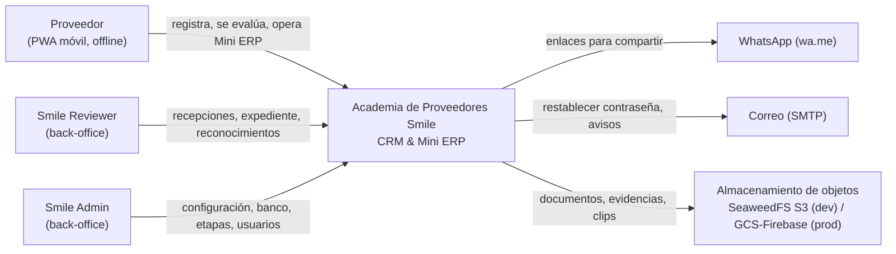

# Arquitectura del sistema

**Versión 1.0 · 15 de octubre de 2026.** Implementa [SPEC-BASE §2], [SPEC-SOT §5] y [SPEC-DASH §1] bajo las decisiones [ADR-0001…0007](../adr/). Requerimientos en [`requerimientos.md`](requerimientos.md).

---

## 1. Vista de contexto (C4 nivel 1)



## 2. Vista de contenedores (C4 nivel 2)

```mermaid
flowchart TB
  subgraph Browser["Navegador del usuario"]
    PWA["Next.js — rutas /app (PWA proveedor)<br/>WatermelonDB · Service Worker (Serwist/Workbox)"]
    BO["Next.js — rutas /smile (back-office)<br/>online, TanStack Query"]
  end
  FE["frontend<br/>Next.js standalone (Node 22)<br/>:3000"]
  API["backend<br/>FastAPI · monolito modular hexagonal<br/>:8000"]
  WK["worker<br/>misma imagen que backend<br/>outbox, cron, reportes"]
  DB[("db<br/>PostgreSQL 16 + TimescaleDB<br/>:5432")]
  S3[("storage<br/>SeaweedFS, API S3<br/>:9000 → 8333")]
  Browser -->|HTML/JS/CSS| FE
  PWA -->|REST /api/v1 + sync pull/push, JSON gzip| API
  BO -->|REST /api/v1| API
  FE -->|SSR: API_INTERNAL_URL| API
  API --> DB
  WK --> DB
  API -->|URLs firmadas| S3
  WK --> S3
  PWA -.->|descarga directa con URL firmada (P3)| S3
```

| Contenedor | Tecnología | Responsabilidad |
|---|---|---|
| `frontend` | Next.js 15 (App Router, TS estricto), Tailwind CSS 4, WatermelonDB (LokiJS + IndexedDB), Serwist, GSAP | Landing `/`, PWA del proveedor `/app/*` (local-first), back-office `/smile/*` (online). |
| `backend` | Python 3.12, FastAPI, Pydantic v2, SQLAlchemy 2 async + asyncpg, Alembic | API REST `/api/v1`, protocolo de sync, reglas de negocio. |
| `worker` | Misma imagen y código que `backend`, otro comando | Despacho del outbox de eventos, tareas programadas (cierre de ciclo, score diario, reconocimientos, vencimientos), generación de reportes. |
| `db` | PostgreSQL 16 + extensión TimescaleDB | Datos transaccionales; *hypertables* para series de tiempo (snapshots de score, transacciones ERP). |
| `storage` | SeaweedFS (API S3) | Documentos del expediente, evidencias, clips y fichas, reportes generados. |

## 3. Backend: monolito modular hexagonal

### 3.1 Principios
1. **Un despliegue, muchos módulos.** Cada módulo es un *bounded context* con su propio modelo, sus tablas (esquema PostgreSQL propio) y su API pública. ADR-0002.
2. **Hexagonal por módulo.** El dominio no conoce FastAPI, SQLAlchemy ni el almacenamiento. ADR-0001.
3. **Comunicación entre módulos** solo por: (a) la fachada `public.py` del otro módulo (llamadas síncronas de consulta o comando), o (b) **eventos de dominio** publicados en el bus interno y persistidos en un *outbox* (transaccional) para efectos asíncronos. Nunca se importan `domain`, `application` ni `infrastructure` de otro módulo, ni se hace JOIN entre esquemas de módulos distintos.
4. **Reglas verificadas en CI** con import-linter (RNF-MNT-001/002).

### 3.2 Estructura de carpetas

```
backend/
├── Dockerfile                 multistage: base → builder → dev | runtime
├── pyproject.toml             uv; ruff, mypy, pytest, import-linter
├── uv.lock
├── alembic.ini
├── migrations/                Alembic (una rama, migraciones por módulo con prefijo)
├── src/smile/
│   ├── main.py                create_app(): composition root, registra módulos
│   ├── worker.py              entrypoint del worker (outbox + scheduler)
│   ├── config.py              Settings (pydantic-settings) desde variables de entorno
│   ├── shared/                kernel compartido, sin reglas de negocio
│   │   ├── domain/            Entity, AggregateRoot, ValueObject, DomainEvent, errores base, Money(COP), Quantity
│   │   ├── application/       UnitOfWork (puerto), EventBus (puerto), Clock (puerto), CurrentUser
│   │   ├── infrastructure/    db (engine, session, Base), outbox, event bus en memoria, storage S3/GCS, clock
│   │   └── api/               errores HTTP, dependencias (auth, uow), paginación, health
│   └── modules/
│       └── <modulo>/
│           ├── public.py      ÚNICA superficie importable por otros módulos (fachada + DTOs + eventos)
│           ├── module.py      registro: routers, handlers de eventos, wiring de adaptadores
│           ├── domain/        entidades, value objects, servicios de dominio, eventos, reglas puras
│           ├── application/
│           │   ├── ports/     interfaces (Protocol): repositorios, gateways salientes
│           │   ├── commands/  casos de uso de escritura (1 clase por caso de uso)
│           │   └── queries/   casos de uso de lectura
│           ├── infrastructure/ adaptadores salientes: repos SQLAlchemy, modelos ORM, gateways
│           └── api/           adaptador entrante: router FastAPI, schemas Pydantic (DTO)
└── tests/
    ├── unit/<modulo>/         dominio y aplicación con fakes de puertos (sin DB)
    ├── integration/<modulo>/  adaptadores contra PostgreSQL real (testcontainers o servicio de compose)
    ├── api/                   contrato HTTP + autorización/IDOR por endpoint
    └── architecture/          contratos import-linter
```

**Dependencias permitidas dentro de un módulo:** `api → application → domain`; `infrastructure → application, domain`; `domain → shared.domain`. `module.py` es el único que conoce a todos para cablear.

### 3.3 Módulos

| Módulo | Esquema DB | Responsabilidad | Publica eventos | Consume eventos |
|---|---|---|---|---|
| `iam` | `iam` | Usuarios, credenciales, roles, tokens, bloqueo | `UserRegistered`, `RoleChanged` | — |
| `privacy` | `privacy` | Consentimientos, declaraciones firmadas, solicitudes ARCO | `ConsentGranted`, `ConsentRevoked` | `UserRegistered` |
| `suppliers` | `suppliers` | Ficha, caracterización, segmento, documentos, visitas, incidentes, expediente | `SupplierProfileCompleted`, `DocumentVerified`, `CertificationVerified` | `UserRegistered` |
| `catalog` | `catalog` | Categorías, ejes, productos y unidades, agroquímicos y carencias, parámetros versionados, DIVIPOLA | `ParametersPublished` | — |
| `assessment` | `assessment` | Banco versionado, ciclos, composición del formulario, respuestas, puntajes por eje, P1, cerca de certificación, alertas críticas | `AssessmentSubmitted`, `CriticalRiskDetected` | `ParametersPublished` |
| `improvement` | `improvement` | Rutas de 3 metas, guías, checklist, evidencias, validación | `PlanGenerated`, `GoalCompleted`, `PlanCompleted` | `AssessmentSubmitted` |
| `erp` | `erp` | Ventas, costos, entradas, mermas, inventario, métricas agregadas | `ErpEntryRecorded`, `WasteRecorded` | — |
| `traceability` | `traceability` | Aplicaciones, lotes, carencia, liberación, rótulos | `LotReleased` | — |
| `receptions` | `receptions` | Recepciones, importación CSV, validación de rótulos, P2 | `ReceptionRecorded` | — |
| `scoring` | `scoring` | P3, score total, funnel, historial, cierre de ciclo | `ScoreRecalculated`, `StageChanged` | casi todos |
| `recognition` | `recognition` | Flores, caritas, insignias, elegibilidad +4 %, beneficios | `RecognitionGranted` | `WasteRecorded`, `ReceptionRecorded`, `ErpEntryRecorded`, `PlanCompleted`, `ContentCompleted`, `StageChanged` |
| `learning` | `learning` | Contenidos, asignaciones, progreso | `ContentCompleted` | `PlanGenerated` |
| `impact` | `impact` | Huella, ROI, SROI (cálculos puros + parámetros) | — | — |
| `reporting` | `reporting` | Dashboards agregados (vistas/materializaciones de solo lectura), exportaciones PDF/XLSX | — | — |
| `notifications` | `notifications` | Mensajes directos, bandeja, alertas internas, correo, push | — | `CriticalRiskDetected`, `RecognitionGranted`, `ConsentRevoked` |
| `sync` | `sync` | Protocolo WatermelonDB pull/push, idempotencia, enrutamiento a módulos por tabla | — | — |

**`reporting` y el principio de no-JOIN:** los dashboards leen de **proyecciones** propias del esquema `reporting`, alimentadas por eventos (ADR-0002). Esto cumple RF-PRV-007 por construcción: la proyección solo guarda agregados del ERP.

**`sync` como adaptador entrante:** recibe el lote de WatermelonDB, lo valida por tabla con el DTO del módulo dueño y llama al comando de ese módulo a través de su `public.py`. No tiene reglas de negocio propias más allá de idempotencia y orden.

### 3.4 Ejemplo de flujo: enviar autoevaluación (CU-05)

```mermaid
sequenceDiagram
  participant PWA
  participant SYNC as sync.api
  participant ASM as assessment.application
  participant UOW as UnitOfWork + Outbox
  participant WK as worker
  participant IMP as improvement
  participant SCO as scoring
  PWA->>SYNC: POST /sync/push {assessment_answers, declaration} (P2)
  SYNC->>SYNC: mutation_id ya visto? → responder OK sin reprocesar
  SYNC->>ASM: SubmitAssessment(cmd) vía assessment.public
  ASM->>ASM: dominio: valida ciclo, calcula ejes, P1, críticas
  ASM->>UOW: guarda Assessment + evento AssessmentSubmitted (misma transacción)
  SYNC-->>PWA: 200 {accepted, rejected[]}
  WK->>UOW: lee outbox (SKIP LOCKED)
  WK->>IMP: on AssessmentSubmitted → GeneratePlan
  WK->>SCO: on AssessmentSubmitted → RecalculateProvisionalScore
  Note over PWA: el plan ya se generó localmente con la misma regla<br/>(motor compartido); el servidor es la versión oficial
```

**Motor de reglas compartido:** el puntaje por eje, el plan de 3 metas, la carencia y los cálculos de impacto deben funcionar offline en la PWA (RF-SYN-001) y ser oficiales en el backend. Se implementan en Python (dominio) y en TypeScript (`frontend/src/domain/`), y **ambos se validan contra los mismos casos de prueba** en `contracts/fixtures/*.json` (ADR-0005).

## 4. Frontend

### 4.1 Rutas

| Grupo | Rutas | Usuarios | Modo |
|---|---|---|---|
| `(marketing)` | `/` | Público | Estático; porta la landing de la maqueta |
| `(auth)` | `/ingresar`, `/registro`, `/recuperar` | Todos | Online (el ingreso offline usa la sesión guardada) |
| `(proveedor)` | `/app`, `/app/consentimiento`, `/app/ficha`, `/app/autoevaluacion`, `/app/diagnostico`, `/app/plan`, `/app/plan/[metaId]`, `/app/erp` (ventas, costos, inventario, mermas), `/app/lotes`, `/app/aprender`, `/app/beneficios`, `/app/mensajes`, `/app/perfil` | PROVEEDOR | **Local-first, offline** |
| `(backoffice)` | `/smile`, `/smile/proveedores`, `/smile/proveedores/[id]`, `/smile/recepciones`, `/smile/funnel`, `/smile/esg`, `/smile/reportes`, `/smile/admin/*` | REVIEWER, ADMIN | Online |

### 4.2 Estructura

```
frontend/
├── Dockerfile                 multistage: deps → builder → dev | runner (standalone)
├── package.json  next.config.ts  tsconfig.json  vitest.config.ts  playwright.config.ts
├── public/                    manifest.webmanifest, íconos, fuentes locales
└── src/
    ├── app/                   App Router (grupos de §4.1)
    ├── design/                tokens.css importado de docs/diseno + capa Tailwind @theme, motion.ts
    ├── components/ui/         primitivos de la GUIA_VISUAL §8 (Button, Answer, Chip, Ring, LeafBar…)
    ├── features/<modulo>/     UI + hooks por módulo (assessment, erp, traceability…)
    ├── domain/                reglas puras en TS espejo del backend (scoring, plan, carencia, impacto)
    ├── data/
    │   ├── db/                WatermelonDB: schema, migrations, modelos
    │   ├── sync/              cliente pull/push, cola P1/P2/P3, backoff, estado
    │   └── api/               cliente generado desde OpenAPI (openapi-typescript + openapi-fetch)
    ├── sw/                    service worker (Serwist): precache, runtime caching, Background Sync
    └── lib/                   formato es-CO, crypto (WebCrypto AES-GCM), auth/sesión
```

### 4.3 Decisiones clave
- **Datos del proveedor:** solo WatermelonDB (observables) → la UI nunca llama a la API para leer o escribir datos de negocio; la API solo se usa en `data/sync` y en auth.
- **Back-office:** no usa WatermelonDB; consulta la API con TanStack Query.
- **Diseño:** `src/design/tokens.css` es una copia generada de `docs/diseno/tokens.css` (script `design:sync` + verificación en CI de que no difieren). Tailwind expone los tokens vía `@theme`. Movimiento con `docs/diseno/motion.js` portado a TS.
- **Presupuesto:** GSAP core + SplitText solo en `/app` (la PWA no usa ScrollTrigger ni Lenis, GUIA_VISUAL §10.6); la landing puede usarlos con carga diferida.
- **Fuentes** Fraunces y Manrope autoalojadas con `next/font/local` (offline).

## 5. Sincronización offline

| Prioridad | Tablas WatermelonDB | Dirección | Límite |
|---|---|---|---|
| P1 | `erp_sales`, `erp_costs`, `erp_stock_entries`, `erp_waste`, `trz_applications`, `trz_lots` | push | lote gzip < 10 KB |
| P2 | `assessment_answers`, `assessments`, `declarations`, `consents`, `supplier_profile`, `goal_checks` | push/pull | lote gzip < 50 KB |
| P3 | `evidences` (subida), clips y fichas (descarga directa a Cache Storage con URL firmada) | push/descarga | ≤ 4 MB por medio |
| Pull | catálogos, banco publicado, formulario compuesto, plan oficial, mensajes, reconocimientos, recepciones propias | pull | — |

**Contrato:**
- `GET /api/v1/sync/pull?last_pulled_at=<ms>&schema_version=<n>` → `{ changes: {tabla: {created, updated, deleted}}, timestamp }`.
- `POST /api/v1/sync/push` con `{ mutation_id, priority, last_pulled_at, changes }` → `{ accepted: [ids], rejected: [{id, table, code, message}] }`.
- Idempotencia: tabla `sync.processed_mutations(mutation_id PK, user_id, processed_at, result)`; reenvíos devuelven el resultado guardado.
- IDs: UUID v4 generados en el cliente; el servidor nunca reasigna IDs.
- Conflictos: RF-SYN-005.

## 6. Seguridad

- **Autenticación:** JWT de acceso (15 min) + refresh rotativo (30 días) en cookie `HttpOnly; Secure; SameSite=Strict` para el back-office; la PWA guarda el refresh en IndexedDB cifrado para permitir el uso offline (RF-IAM-003, ADR-0006).
- **Autorización:** dependencia FastAPI `require(permission)` + verificación de propiedad del recurso en la capa de aplicación (no en el router).
- **Privacidad por diseño:** RF-PRV-007 se garantiza porque `erp` no expone consultas de filas a roles internos y `reporting` solo almacena agregados.
- **Archivos:** subida mediante URL prefirmada PUT con tipo y tamaño fijados; validación por *magic bytes* en un handler posterior; descarga con URL firmada de 15 min.
- **Auditoría:** tabla `shared.audit_log` escrita por un decorador de casos de uso internos.

## 7. Contrato de infraestructura

Este contrato lo comparten `frontend/`, `backend/` e `infra/`. Cambiarlo exige actualizar este documento y [`PLAN_INFRA.md`](../planes/PLAN_INFRA.md).

### 7.1 Servicios de Docker Compose (`infra/docker-compose.yml`)

| Servicio | Imagen / build | Puerto host | Depende de | Healthcheck |
|---|---|---|---|---|
| `db` | `timescale/timescaledb:2.17.2-pg16` | 5432 | — | `pg_isready` |
| `storage` | `chrislusf/seaweedfs:3.97` (`weed server -s3`) | 9000 → 8333 | — | `/cluster/status` y `/healthz` |
| `storage-init` | `chrislusf/seaweedfs:3.97` (`weed shell`) | — | storage sano | crea bucket `${S3_BUCKET}` si no existe y termina |
| `migrate` | build `../backend` target `runtime` | — | db sano | `alembic upgrade head` y termina |
| `backend` | build `../backend` target `runtime` (`dev` en override) | 8000 | migrate completado, storage-init completado | `GET /health/ready` |
| `worker` | misma imagen que backend, `python -m smile.worker` | — | migrate completado | proceso vivo |
| `frontend` | build `../frontend` target `runner` (`dev` en override) | 3000 | backend sano | `GET /api/health` de Next |
| `mailpit` (perfil `dev`) | `axllent/mailpit` | 8025, 1025 | — | — |

### 7.2 Variables de entorno

| Variable | Servicio | Ejemplo dev | Descripción |
|---|---|---|---|
| `POSTGRES_USER` / `POSTGRES_PASSWORD` / `POSTGRES_DB` | db | `smile` / `smile` / `smile` | Credenciales DB |
| `DATABASE_URL` | backend, worker, migrate | `postgresql+asyncpg://smile:smile@db:5432/smile` | Conexión SQLAlchemy |
| `APP_ENV` | backend, worker | `development` | `development` · `test` · `production` |
| `LOG_LEVEL` | backend, worker | `INFO` | |
| `TZ` | todos | `America/Bogota` | RNF-I18N-001 |
| `JWT_SECRET` | backend | (generar) | Firma de tokens |
| `JWT_ACCESS_TTL_MIN` / `JWT_REFRESH_TTL_DAYS` | backend | `15` / `30` | S-13 |
| `CORS_ORIGINS` | backend | `http://localhost:3000` | Lista separada por comas |
| `STORAGE_PROVIDER` | backend, worker | `s3` | `s3` (SeaweedFS o cualquier S3) · `gcs` |
| `S3_ENDPOINT_URL` | backend, worker | `http://storage:8333` | Endpoint interno |
| `S3_PUBLIC_ENDPOINT_URL` | backend | `http://localhost:9000` | Host usado al firmar URLs para el navegador |
| `S3_ACCESS_KEY` / `S3_SECRET_KEY` | backend, worker, storage | `smile` / `smile-secret` | Identidad S3 que SeaweedFS acepta en dev |
| `S3_BUCKET` / `S3_REGION` | backend, worker, storage-init | `smile-files` / `us-east-1` | |
| `SMTP_HOST` / `SMTP_PORT` | backend, worker | `mailpit` / `1025` | |
| `NEXT_PUBLIC_API_URL` | frontend (build y runtime) | `http://localhost:8000` | URL de la API vista por el navegador |
| `API_INTERNAL_URL` | frontend (servidor) | `http://backend:8000` | URL de la API dentro de la red de compose |

### 7.3 Endpoints transversales
`GET /health/live` (proceso vivo) · `GET /health/ready` (DB y storage accesibles; 503 con `{"db": "down"}` si fallan) · `GET /api/v1/openapi.json` · `GET /docs` (solo fuera de producción) · `GET /metrics`.

### 7.4 Dockerfiles multistage (ADR-0003)

| Imagen | Etapas | Runtime |
|---|---|---|
| `backend` | `base` (python:3.12-slim + uv) → `builder` (`uv sync --frozen --no-dev` en `/app/.venv`) → `dev` (con dependencias de desarrollo, `uvicorn --reload`) · `runtime` (python:3.12-slim, copia `.venv` y `src`, usuario no root `app`, `uvicorn smile.main:app`) | < 250 MB |
| `frontend` | `deps` (node:22-alpine, `npm ci`) → `builder` (`next build`, `output: "standalone"`) → `dev` (`next dev`) · `runner` (node:22-alpine, copia `.next/standalone`, `.next/static`, `public`; usuario `nextjs`) | < 200 MB |

## 8. Decisiones registradas

| ADR | Decisión |
|---|---|
| [ADR-0001](../adr/ADR-0001-arquitectura-hexagonal.md) | Arquitectura hexagonal (puertos y adaptadores) en el backend |
| [ADR-0002](../adr/ADR-0002-monolito-modular.md) | Monolito modular con módulos por bounded context, fachada pública y outbox |
| [ADR-0003](../adr/ADR-0003-monorepo-docker-multistage.md) | Monorepo `frontend/` `backend/` `infra/` con Docker Compose y builds multistage |
| [ADR-0004](../adr/ADR-0004-almacenamiento-objetos.md) | Puerto `FileStorage` con S3 en desarrollo y GCS/Firebase en producción |
| [ADR-0008](../adr/ADR-0008-seaweedfs-en-desarrollo.md) | SeaweedFS reemplaza a MinIO como servidor S3 de desarrollo |
| [ADR-0005](../adr/ADR-0005-local-first-watermelondb.md) | Local-first con WatermelonDB y motor de reglas duplicado validado por fixtures compartidos |
| [ADR-0006](../adr/ADR-0006-cifrado-local-y-sesion-offline.md) | Cifrado de campos sensibles en el dispositivo y sesión offline de 30 días |
| [ADR-0007](../adr/ADR-0007-tareas-asincronas-outbox.md) | Tareas asíncronas con outbox en PostgreSQL y worker, sin broker externo |
