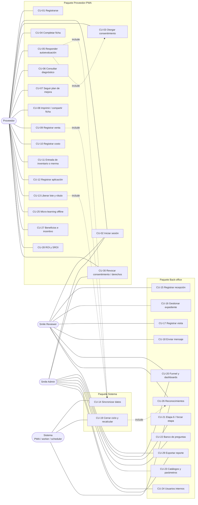
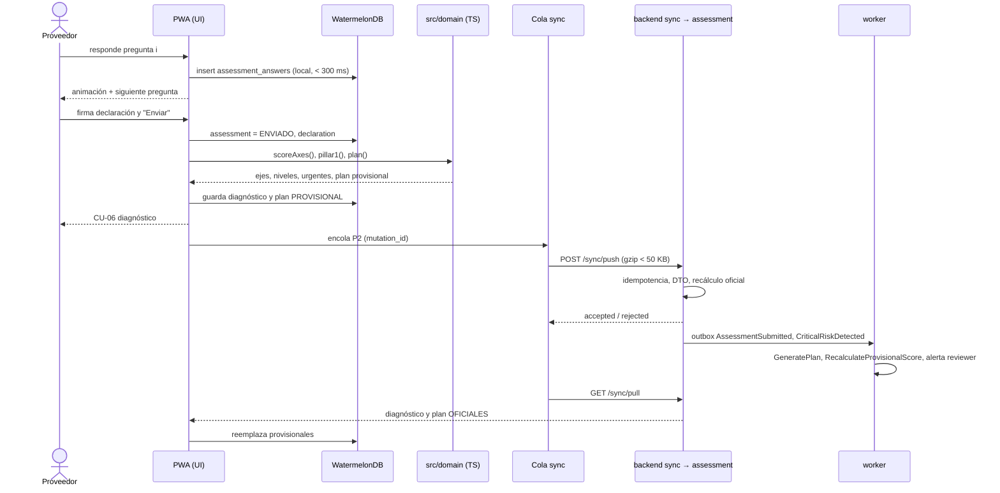
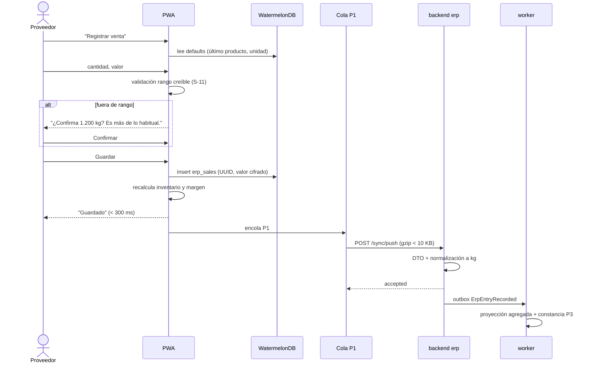
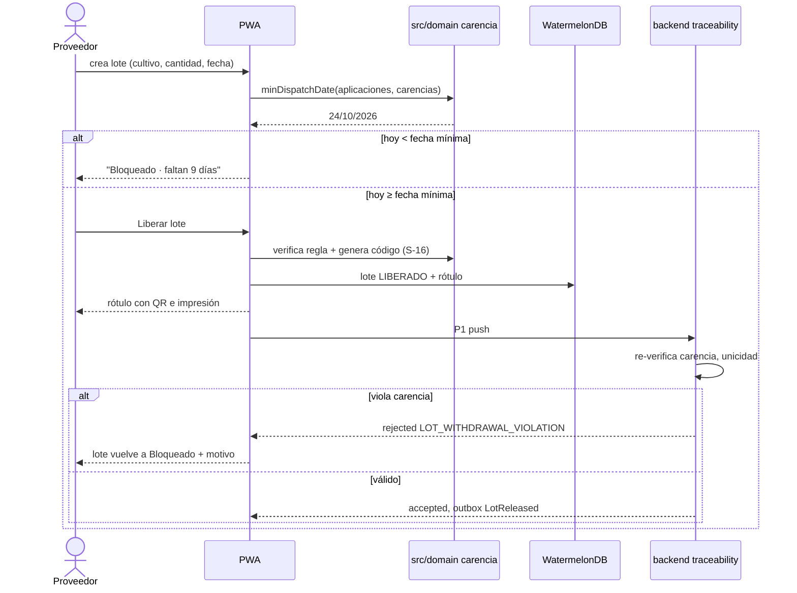
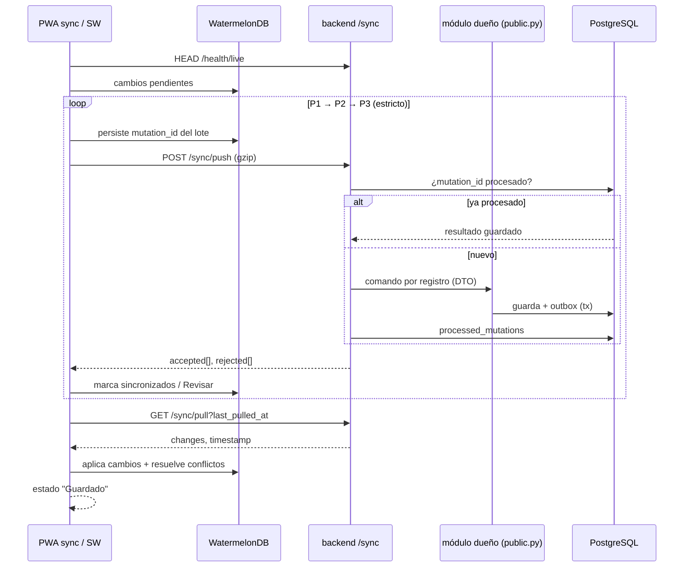
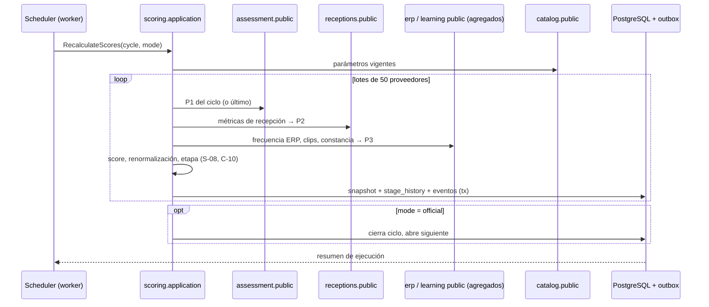

# Casos de uso

**Versión 1.0 · 15 de octubre de 2026**

Fuentes: [`requerimientos.md`](requerimientos.md) (catálogo §6 y requerimientos citados), [`conflictos-y-supuestos.md`](conflictos-y-supuestos.md) (reglas `C-xx`, `S-xx`, `Q-xx`) y [`../specs/README.md`](../specs/README.md) (notación `[SPEC-… §x]`). Arquitectura y módulos en [`arquitectura.md`](arquitectura.md).

## Plantilla

Formato "completamente vestido" (A. Cockburn). Cada caso contiene:

| Campo | Contenido |
|---|---|
| Actor principal / secundarios | Rol del sistema (`PROVEEDOR`, `REVIEWER`, `ADMIN`) o actor de sistema (PWA, worker, scheduler) |
| Nivel | **Objetivo de usuario** (una sesión, un logro con valor) o **Subfunción** (paso reutilizado por otros casos) |
| Release | R0–R6 según `requerimientos.md` §5 |
| Requerimientos | IDs exactos de `requerimientos.md` |
| Fuente | Sección del spec que lo origina |
| Precondiciones / Disparador | Estado requerido antes de empezar y evento que lo inicia |
| Flujo principal | Pasos numerados, el sistema y el actor alternan |
| Alternativos (A) y excepciones (E) | `A3.1` = alternativa en el paso 3. Siempre se describe el comportamiento sin conexión cuando aplica |
| Postcondiciones | Garantía mínima (fallo) y de éxito |
| Reglas de negocio | Supuestos y resoluciones aplicadas |
| Datos | Entidades / tablas tocadas (esquema del módulo) |
| Frecuencia | Volumen esperado en operación |

**Convenciones del flujo:** "la PWA" ejecuta localmente contra WatermelonDB (RF-SYN-001); "el sistema" sin calificar en flujos del proveedor también es local; "el backend" indica procesamiento en servidor. Los mensajes al usuario siguen el tono de [SPEC-SOT D2 §3]: directos, respetuosos, sin jerga, sin felicitaciones exageradas.

## Diagrama de actores

---

## CU-01 · Registrarse como proveedor

| Campo | Valor |
|---|---|
| Actor principal | Proveedor (anónimo) |
| Secundarios | — |
| Nivel | Objetivo de usuario |
| Release | R1 |
| Requerimientos | RF-IAM-001, RF-IAM-004, RNF-SEC-002, RNF-SEC-005, RNF-USA-001 |
| Fuente | [SPEC-SOT §1] (el cliente se registra libremente) |
| Precondiciones | El usuario tiene conexión (el registro crea la cuenta en el servidor). La PWA está cargada. |
| Disparador | El usuario toca "Crear cuenta" en `/registro`. |

**Flujo principal**
1. La PWA muestra el formulario: nombre completo, celular, correo (opcional si hay celular), contraseña y confirmación.
2. El proveedor ingresa sus datos.
3. La PWA valida en el cliente: nombre ≥ 3 caracteres; celular de 10 dígitos que inicia en 3; correo con formato válido si se ingresa; al menos celular o correo; contraseña ≥ 8 caracteres; confirmación igual.
4. El proveedor toca "Crear cuenta".
5. La PWA envía `POST /api/v1/auth/register` sin campo de rol.
6. El backend valida el DTO, verifica que el celular y el correo no estén registrados, aplica rate limit (10/min/IP), guarda la contraseña con Argon2id y crea el usuario con rol `PROVEEDOR`.
7. El backend publica `UserRegistered` (outbox); `suppliers` crea una ficha vacía en estado incompleto y `privacy` registra que hay consentimiento pendiente.
8. El backend emite access token (15 min) y refresh token (30 días).
9. La PWA genera la clave local AES-GCM (ADR-0006), guarda el refresh token cifrado y lleva al usuario a CU-03.

**Alternativos y excepciones**
- E3.1 Dato inválido: la PWA marca el campo y muestra el motivo en una línea ("El celular debe tener 10 dígitos y empezar por 3."). No se envía nada.
- E5.1 Sin conexión: la PWA muestra "Para crear la cuenta necesita señal. Sus datos quedan escritos aquí; intente de nuevo cuando tenga conexión." y conserva lo digitado en el formulario (no en la base).
- E6.1 Celular o correo ya registrado: 409; la PWA ofrece "Ingresar" y "Recuperar contraseña".
- E6.2 Si el payload incluye `role`, el backend lo ignora (RF-IAM-001) y registra el intento en logs de seguridad.
- A1.1 Registro asistido por un reviewer: ver RF-IAM-008 (se inicia desde back-office; el consentimiento sigue siendo del proveedor en CU-03).

**Postcondiciones**
- Éxito: usuario `PROVEEDOR` activo, ficha en blanco (etapa aún no asignada; E1 se alcanza al completar la ficha en CU-04), sesión iniciada, consentimiento pendiente.
- Fallo: no se crea usuario; no queda ningún dato personal en el dispositivo fuera del formulario.

**Reglas de negocio:** C-09 (tres roles; el registro libre solo crea `PROVEEDOR`). S-13 (vigencia de sesión).
**Datos:** `iam.users`, `iam.refresh_tokens`, `suppliers.suppliers` (creada por evento), `privacy.consent_status`.
**Frecuencia:** ~450 en total; picos de 30–50 por jornada de socialización veredal.

---

## CU-02 · Iniciar sesión (con y sin conexión)

| Campo | Valor |
|---|---|
| Actor principal | Proveedor, Reviewer, Admin |
| Nivel | Subfunción |
| Release | R1 |
| Requerimientos | RF-IAM-002, RF-IAM-003, RF-IAM-006, RF-IAM-009, RNF-SEC-003, RNF-SEC-005 |
| Fuente | [SPEC-BASE §2.1], [SPEC-BASE §8.1] |
| Precondiciones | Cuenta activa. Para ingreso offline: sesión previa en este dispositivo con refresh token vigente. |
| Disparador | El usuario abre la app o toca "Ingresar". |

**Flujo principal (con conexión)**
1. La PWA detecta que no hay sesión válida y muestra `/ingresar`: celular o correo, contraseña.
2. El usuario ingresa credenciales y toca "Ingresar".
3. La PWA envía `POST /api/v1/auth/login`.
4. El backend verifica que la cuenta no esté bloqueada, valida la contraseña (Argon2id) y reinicia el contador de intentos.
5. El backend emite access token (15 min) y refresh token rotativo (30 días); para back-office el refresh va en cookie `HttpOnly; Secure; SameSite=Strict`.
6. Según el rol: `PROVEEDOR` → `/app` (o CU-03 si el consentimiento está pendiente); `REVIEWER`/`ADMIN` → `/smile`.
7. La PWA del proveedor dispara CU-14 (pull inicial).

**Flujo alternativo: ingreso sin conexión**
- A1.1 Al abrir la app sin red, la PWA encuentra la clave local y el refresh token cifrado con vencimiento futuro: entra directamente a `/app` y muestra el estado "Sin conexión · guardado". No se pide contraseña.
- A1.2 Al recuperar señal, la PWA renueva tokens con el refresh (rotación) sin interrumpir al usuario; los datos locales se conservan (RF-IAM-003).

**Excepciones**
- E4.1 Credenciales inválidas: "El celular o la contraseña no coinciden." Se incrementa el contador.
- E4.2 Quinto intento fallido consecutivo: la cuenta se bloquea 15 min; mensaje "Por seguridad, la cuenta queda en pausa 15 minutos." (RF-IAM-006).
- E5.1 Refresh token reutilizado (detección de robo): el backend revoca toda la familia de tokens y exige nuevo ingreso.
- EA.1 Refresh vencido estando offline: la PWA permite **ver** datos ya descifrados en memoria no; muestra "Su sesión venció. Conéctese para ingresar de nuevo. Sus registros pendientes se conservan." Los registros no sincronizados permanecen en WatermelonDB.
- E-cierre: al cerrar sesión con pendientes, la PWA advierte "Tiene N registros sin enviar. Si cierra sesión ahora se perderán." y solo borra la clave tras confirmación (RF-IAM-009).

**Postcondiciones:** Éxito: sesión válida y rol resuelto. Fallo: sin sesión; contador de intentos actualizado.
**Reglas:** S-13.
**Datos:** `iam.users`, `iam.refresh_tokens`, `iam.login_attempts`; IndexedDB `session`.
**Frecuencia:** Proveedor: ingreso con contraseña ~1 vez cada 30 días; aperturas diarias offline. Internos: diaria.

---

## CU-03 · Otorgar consentimiento de datos

| Campo | Valor |
|---|---|
| Actor principal | Proveedor |
| Nivel | Subfunción (bloqueante del primer registro) |
| Release | R1 |
| Requerimientos | RF-PRV-001, RF-PRV-002, RF-PRV-003, RNF-LEG-001 |
| Fuente | [SPEC-BASE §8.2], [SPEC-DASH §1.2], [SPEC-SOT D2 §4.3], [DOC-AUTOEVAL] |
| Precondiciones | Sesión iniciada; no existe consentimiento general vigente para la versión de texto actual. |
| Disparador | Primer ingreso, o publicación de una nueva versión del texto de autorización. |

**Flujo principal**
1. La PWA bloquea toda pantalla de captura y muestra `/app/consentimiento`.
2. La PWA presenta el texto de autorización (versión vigente, descargada en catálogo o embebida): responsable (Grupo Smile Bogotá S.A.S.), finalidades (acompañamiento técnico, indicadores agregados, bonificaciones), derechos (conocer, actualizar, rectificar, suprimir, revocar) y canal `sostenibilidad@smilebogota.com`.
3. El proveedor lee y marca "Autorizo el tratamiento de mis datos personales".
4. La PWA presenta, en una segunda pantalla, la autorización **separada y opcional** de datos sensibles (liderazgo y empleo diverso, etnia, víctimas, discapacidad), con texto "Responder es voluntario y no cambia su evaluación".
5. El proveedor elige "Autorizo" o "No autorizo".
6. La PWA guarda localmente dos registros inmutables: tipo (general/sensible), decisión, versión del texto, hash SHA-256 del texto, fecha-hora del dispositivo, método (casilla).
7. La PWA desbloquea la captura y encola los consentimientos en P2 (CU-14).
8. El backend, al recibirlos, añade la fecha-hora del servidor y los persiste sin permitir actualización.

**Alternativos y excepciones**
- A5.1 No autoriza datos sensibles: las preguntas sensibles de CU-04 y CU-05 se muestran solo con la opción "Prefiero no responder" preseleccionada y no editable.
- A3.1 El proveedor no acepta la autorización general: la PWA explica en una línea que sin autorización no puede guardar información y ofrece "Hablar con Smile" (RF-NOT-002). No se captura nada.
- A1.1 Sin conexión: el flujo es idéntico; el registro queda en P2 hasta que haya red. El texto se toma de la última versión descargada.
- E8.1 Hash del texto no coincide con ninguna versión publicada: el backend rechaza el registro (`rejected`, código `CONSENT_TEXT_UNKNOWN`) y la PWA vuelve a pedir el consentimiento con el texto actual.

**Postcondiciones:** Éxito: consentimiento general vigente (y sensible según decisión) en local y, al sincronizar, en servidor. Fallo: captura bloqueada.
**Reglas:** RF-PRV-002 ("Prefiero no responder" no afecta score, etapa ni plan).
**Datos:** `privacy.consents` (append-only), WatermelonDB `consents`.
**Frecuencia:** 1–2 por proveedor; se repite solo al cambiar la versión del texto.

---

## CU-04 · Completar y actualizar la ficha

| Campo | Valor |
|---|---|
| Actor principal | Proveedor |
| Nivel | Objetivo de usuario |
| Release | R1 |
| Requerimientos | RF-SUP-001, RF-SUP-002, RF-SUP-003, RF-PRV-002, RF-CAT-001 |
| Fuente | [SPEC-SOT §1.1 E1], [SPEC-SOT §1.3], [DOC-AUTOEVAL §I] |
| Precondiciones | Consentimiento general vigente (CU-03). Catálogos de categorías y DIVIPOLA descargados. |
| Disparador | Paso siguiente al consentimiento, o "Mi perfil" → "Editar ficha". |

**Flujo principal**
1. La PWA muestra la ficha en pasos cortos (máx. 4 campos por pantalla) con barra de progreso.
2. Paso "Identificación": tipo de persona (natural/jurídica), número de NIT o cédula y dígito de verificación, nombre o razón social, representante legal (solo jurídica).
3. La PWA valida el dígito de verificación con el algoritmo módulo 11 DIAN; si no coincide, lo indica en el campo.
4. Paso "Ubicación": departamento y municipio (lista DIVIPOLA con búsqueda), vereda (opcional), "Usar mi ubicación" para coordenadas (opcional).
5. Paso "Contacto y categoría": canal preferido (WhatsApp, llamada, correo), categoría principal (solo las ACTIVAS: Fruver en el piloto) y secundarias.
6. Paso "Su empresa": tamaño (Micro/unipersonal, Pequeña, Mediana, Grande), origen (nacional con productos nacionales / nacional con importados / filial extranjera), reporte de sostenibilidad (sí/no).
7. Paso "Diversidad" (sensible): liderazgo de mujeres, liderazgo diverso, empleo diverso; cada pregunta con "Prefiero no responder".
8. El proveedor toca "Guardar"; la PWA escribe en `supplier_profile` cifrando los campos sensibles (RF-PRV-008) y muestra "Guardado".
9. La PWA encola la ficha en P2 (CU-14). Cuando todos los campos obligatorios están completos, la ficha queda completa.
10. El backend valida y publica `SupplierProfileCompleted`; `scoring` asigna la etapa E1.

**Alternativos y excepciones**
- A1.1 Sin conexión: todo el flujo es local; la etapa E1 se refleja al sincronizar.
- A6.1 El tamaño elegido cambia el número de preguntas del próximo ciclo (CU-05); si hay un ciclo en curso ya compuesto, no se recompone.
- A8.1 Edición posterior: cada campo editado se marca con su `updated_at`; en conflicto gana la última escritura por campo (RF-SYN-005).
- E3.1 DV inválido: no se puede avanzar del paso 2. Mensaje: "El dígito de verificación no corresponde al número. Revíselo en su RUT."
- E10.1 El backend rechaza por NIT duplicado en otra cuenta: `rejected` con `SUPPLIER_TAX_ID_TAKEN`; la PWA marca el campo y ofrece contactar a Smile.
- A7.1 Sin consentimiento sensible: paso 7 se muestra resuelto con "Prefiero no responder" (CU-03 A5.1).

**Postcondiciones:** Éxito: ficha completa, E1. Fallo: ficha parcial guardada localmente, sin etapa.
**Reglas:** C-08 (categorías), S-08 (E1 = ficha obligatoria completa).
**Datos:** `suppliers.suppliers`, `suppliers.characterization`, `catalog.divipola`, WatermelonDB `supplier_profile`.
**Frecuencia:** 1 alta por proveedor; 1–3 actualizaciones al año.

---

## CU-05 · Responder la autoevaluación cuatrimestral

| Campo | Valor |
|---|---|
| Actor principal | Proveedor |
| Secundarios | Backend (`assessment`, `improvement`, `scoring`, `notifications`), Reviewer (recibe alertas críticas) |
| Nivel | Objetivo de usuario |
| Release | R1 |
| Requerimientos | RF-ASM-001, RF-ASM-002, RF-ASM-003, RF-ASM-004, RF-ASM-005, RF-ASM-006, RF-ASM-007, RF-ASM-008, RF-ASM-009, RF-ASM-010, RF-PRV-004, RF-PRV-002, RF-IMP-001, RNF-OFF-001, RNF-USA-001, RNF-USA-006 |
| Fuente | [SPEC-SOT §3.1], [SPEC-SOT §3.2], [SPEC-SOT §1.1 E2], [SPEC-BASE §5.1], [SPEC-BASE §5.3], [DOC-AUTOEVAL] |
| Precondiciones | Ficha completa (E1). Consentimiento vigente. Hay un ciclo abierto (C1 ene–abr, C2 may–ago, C3 sep–dic) y el proveedor no ha enviado autoevaluación en él. El formulario compuesto del ciclo está descargado (se compone en el primer pull con red del ciclo). |
| Disparador | El proveedor toca "Empezar autoevaluación" en `/app` o en el recordatorio. |

**Composición (previa, en servidor, al primer pull del ciclo)**
- C.1 El backend toma la versión publicada del banco para la categoría principal.
- C.2 Filtra preguntas aplicables por tamaño, tipo de persona y categoría.
- C.3 Selecciona por prioridad hasta el límite: Micro ≤ 8, Pequeña/Mediana ≤ 15, Grande ≤ 25, garantizando ≥ 1 por eje (BPA, Residuos, Carbono, Trabajo infantil, DDHH/SST).
- C.4 Guarda `assessment_forms` (versión del banco, ciclo, lista ordenada por eje) y lo entrega en el pull.

**Flujo principal**
1. La PWA muestra la portada: número de preguntas ("8 preguntas, unos 5 minutos"), y que se puede pausar.
2. La PWA crea localmente un `assessment` en estado `EN_CURSO` con el id del formulario y el ciclo.
3. La PWA muestra una pregunta por pantalla: chip del eje, texto, ayuda contextual y botones grandes (≥ 74 px): Sí / A veces / No, más "No aplica" si la pregunta lo permite y "Prefiero no responder" si es sensible.
4. El proveedor toca una respuesta; la PWA la guarda en `assessment_answers` de inmediato, anima la selección y avanza a los 560 ms (GUIA_VISUAL §8.4); la barra de progreso avanza.
5. Si la respuesta coincide con `critical_when` de la pregunta, la PWA muestra en la misma pantalla el mensaje crítico de la pregunta (p. ej. trabajo infantil: "Los menores de 15 años no pueden trabajar en la finca. Entre 15 y 17 años solo labores livianas con permiso del inspector, sin agroquímicos ni cargas de más de 15 kg.") antes de avanzar.
6. Repite 3–5 hasta la última pregunta. El proveedor puede tocar "Atrás" para cambiar una respuesta anterior.
7. La PWA muestra el resumen de respuestas por eje y la **declaración formal**: "Declaro que la información es veraz y refleja el estado actual de mi finca o empresa." con casilla y firma táctil (o nombre completo).
8. El proveedor firma y toca "Enviar".
9. La PWA marca el `assessment` como `ENVIADO` (inmutable), guarda la declaración (firma cifrada) y calcula localmente con `src/domain`: puntaje por eje `Σ(peso×valor)/Σ(pesos aplicables)×100`, nivel, urgencia, Pilar 1 y % cerca de BPA ICA.
10. La PWA genera localmente la Ruta de 3 metas (regla S-09) marcada como `PROVISIONAL` y lleva a CU-06 con la animación "Analizando" (~2,6 s).
11. La PWA encola respuestas + declaración en **P2** (< 50 KB) y dispara CU-14.
12. El backend recalcula con su propio dominio, persiste el resultado oficial y publica `AssessmentSubmitted` (y `CriticalRiskDetected` si aplica). El worker genera el plan oficial (`improvement`), recalcula el score provisional (`scoring`, etapas E2/E3) y alerta a reviewers (`notifications`). En el siguiente pull el resultado oficial reemplaza al local.

**Alternativos y excepciones**
- A1.1 **Sin conexión durante todo el flujo:** pasos 1–10 idénticos; el envío queda en P2 con estado "N pendientes" y el diagnóstico se muestra como provisional ("Calculado en su teléfono; se confirma al conectarse.").
- A1.2 Formulario no descargado (nunca hubo red en el ciclo): la PWA muestra "Necesita conectarse una vez para recibir las preguntas de este cuatrimestre." y el botón de soporte.
- A4.1 Pausa: si el proveedor sale, al volver la PWA reanuda en la primera pregunta sin respuesta.
- A4.2 Pregunta numérica u opción múltiple: se muestra el control correspondiente; no cuenta en el puntaje si el banco no la ponderó.
- A9.1 Todas las preguntas de un eje son "No aplica"/"Prefiero no responder": el eje queda sin puntaje y fuera del Pilar 1 y del plan (fixture caso 3).
- A9.2 Eje con respuesta crítica: nivel limitado a "En desarrollo" y marcado urgente (fixture caso 2).
- E8.1 Sin firma ni casilla: "Enviar" permanece deshabilitado.
- E12.1 El ciclo cerró antes de que el envío llegara al servidor: si la fecha del dispositivo del envío está dentro del ciclo y el retraso es ≤ 15 días, se acepta en ese ciclo; si no, `rejected` con `CYCLE_CLOSED` y la PWA explica que las respuestas se usarán como borrador del ciclo siguiente.
- E12.2 Ya existe autoevaluación enviada en el ciclo (otro dispositivo): `rejected` `ASSESSMENT_ALREADY_SUBMITTED`; la PWA descarta la local y muestra la oficial.
- E12.3 Divergencia entre cálculo local y oficial: gana el servidor; se registra métrica `rules_divergence` para revisar el espejo TS (ADR-0005).

**Postcondiciones:** Éxito: autoevaluación inmutable del ciclo, diagnóstico y plan oficiales, etapa E2→E3, alerta crítica notificada si aplica. Garantía mínima: las respuestas dadas quedan guardadas localmente aunque el flujo se interrumpa.
**Reglas:** C-02, C-03, C-04, S-01, S-02, S-03, S-04, S-09.
**Datos:** `assessment.forms`, `assessment.assessments`, `assessment.answers`, `assessment.axis_scores`, `privacy.declarations`, `improvement.plans`; WatermelonDB `assessments`, `assessment_answers`, `declarations`.
**Frecuencia:** 1 por proveedor por ciclo (≈ 1.350/año); picos en las 2 últimas semanas del ciclo.

---

## CU-06 · Consultar el diagnóstico

| Campo | Valor |
|---|---|
| Actor principal | Proveedor |
| Nivel | Objetivo de usuario |
| Release | R1 |
| Requerimientos | RF-ASM-009, RF-ASM-013, RF-ASM-007, RF-CAL-005, RNF-USA-004, RNF-ACC-001 |
| Fuente | [SPEC-BASE §5.3], [SPEC-DASH (proveedor)], [SPEC-SOT D2 §3] |
| Precondiciones | Al menos una autoevaluación enviada (local u oficial). |
| Disparador | Fin de CU-05, o tab "Diagnóstico". |

**Flujo principal**
1. La PWA lee de WatermelonDB el diagnóstico del ciclo más reciente.
2. Muestra el anillo con el Pilar 1 (0–100) y su nivel general, con la animación de conteo (GUIA_VISUAL §9.4).
3. Muestra la etiqueta de estado: "Confirmado" (oficial) o "Calculado en su teléfono" (provisional).
4. Muestra "Está a X % de la certificación BPA del ICA" (RF-ASM-009).
5. Lista los ejes con ícono, nombre, barra, puntaje y nivel (Inicial / En desarrollo / Avanzado), con texto además del color.
6. Si hay ejes urgentes, muestra arriba la alerta con el mensaje crítico y el enlace a la meta correspondiente del plan.
7. El proveedor toca un eje y ve las preguntas que más restaron puntos con la explicación práctica (sin códigos normativos visibles).
8. El proveedor toca "Ver mi plan" → CU-07.

**Alternativos:** A1.1 Sin conexión: igual, con datos locales. A1.2 Ciclos anteriores: selector de ciclo muestra el histórico y la variación por eje. A2.1 `prefers-reduced-motion`: sin animación de conteo.
**Postcondiciones:** Ninguna escritura.
**Reglas:** S-03 (niveles).
**Datos:** lectura de `assessments`, `axis_scores`, `plans` (WatermelonDB).
**Frecuencia:** 2–5 consultas por proveedor por ciclo.

---

## CU-07 · Seguir el plan de mejora

| Campo | Valor |
|---|---|
| Actor principal | Proveedor |
| Secundarios | Reviewer (valida/reabre metas, RF-IMP-005) |
| Nivel | Objetivo de usuario |
| Release | R1 (foto de evidencia R2) |
| Requerimientos | RF-IMP-001, RF-IMP-002, RF-IMP-003, RF-IMP-004, RF-IMP-005, RF-CAL-001, RF-CAL-005 |
| Fuente | [SPEC-SOT §1.1 E3–E4], [SPEC-BASE §5.3], [DOC-MATRIZ §16], [DOC-FRUVER §2] |
| Precondiciones | Plan generado (provisional u oficial) en el ciclo. Guías descargadas. |
| Disparador | Tab "Guías" o "Ver mi plan". |

**Flujo principal**
1. La PWA muestra las 3 metas ordenadas por prioridad (Urgente, Alta, Media, Mantener) con chip, título, minutos estimados y progreso del checklist. La primera va destacada.
2. El proveedor abre una meta.
3. La PWA muestra hallazgo, acción, responsable, fecha límite (cierre del ciclo), evidencia de cierre esperada y la guía: pasos numerados, checklist, consejo, fuente normativa y recursos de micro-learning.
4. El proveedor marca un ítem del checklist; la PWA lo guarda (`goal_checks`), anima la casilla y actualiza el progreso.
5. En la guía de Carbono, el proveedor usa la calculadora: galones de diésel, galones de gasolina, kg de N sintético, kWh de red; la PWA calcula `kgCO₂e = diésel·10,21 + gasolina·8,89 + N·2,45 + kWh·0,164` con la versión de factores mostrada.
6. Al completar el 100 % del checklist, la meta queda "Completa"; la PWA muestra un mensaje sobrio ("Meta completa.") y, si las 3 están completas, "Plan del cuatrimestre completo.".
7. (R2) El proveedor adjunta opcionalmente una foto como evidencia; la PWA la comprime a ≤ 1 MB y la encola para subida.
8. Los cambios se encolan en P2 (checks) y la evidencia en P3 (CU-14).
9. El backend publica `GoalCompleted` / `PlanCompleted`; `scoring` evalúa E4 y `recognition` la Carita por plan al 100 % (R4).

**Alternativos y excepciones**
- A1.1 Sin conexión: todo funciona; la foto espera red (P3).
- A3.1 Meta reabierta por un reviewer: la meta vuelve a "En curso" con el comentario visible arriba ("Comentario de Smile: …").
- A3.2 Meta validada por un reviewer: muestra sello "Validada por Smile" y bloquea desmarcar ítems.
- A4.1 Desmarcar un ítem: permitido mientras la meta no esté validada.
- E5.1 Valor no numérico o negativo en la calculadora: el campo lo rechaza.
- E7.1 Foto mayor a 1 MB tras compresión: se reduce resolución hasta cumplir; si no es posible, "La foto es muy pesada; tome otra con menos luz de fondo." (sin enviarla).

**Postcondiciones:** checks y evidencias persistidos localmente y, tras sync, en servidor.
**Reglas:** S-09, C-12 (factores DOC-FRUVER).
**Datos:** `improvement.plans`, `improvement.goals`, `improvement.goal_checks`, `improvement.evidences`, `catalog.parameters` (factores).
**Frecuencia:** 5–20 interacciones por proveedor por ciclo.

---

## CU-08 · Imprimir o compartir la ficha resumen

| Campo | Valor |
|---|---|
| Actor principal | Proveedor |
| Nivel | Objetivo de usuario |
| Release | R1 |
| Requerimientos | RF-IMP-007, RF-NOT-002, RNF-OFF-001 |
| Fuente | [DOC-FRUVER §3], [SPEC-SOT §4.1] |
| Precondiciones | Diagnóstico y plan disponibles localmente. |
| Disparador | Tab "Ficha". |

**Flujo principal**
1. La PWA arma la ficha: nombre y finca, municipio, ciclo, puntaje Pilar 1, tabla de ejes con nivel, 3 metas con acción y método de control, fecha de generación.
2. El proveedor elige "Descargar o imprimir".
3. La PWA renderiza la versión A4 monocromática de alto contraste (margen 14 mm) y abre el diálogo de impresión del sistema ("Guardar como PDF" en el celular).
4. Alternativamente, el proveedor elige "Enviar por WhatsApp".
5. La PWA arma el texto plano (< 1 KB) con los mismos datos y abre `https://wa.me/?text=…`.
6. El proveedor elige el contacto (asociación, técnico) en WhatsApp.

**Alternativos:** A1.1 Sin conexión: impresión y PDF funcionan; el enlace `wa.me` abre WhatsApp, que enviará el mensaje cuando tenga red. E3.1 Navegador sin `window.print` (algunos WebView): se ofrece descargar la imagen PNG de la ficha.
**Postcondiciones:** Ninguna escritura en base de datos.
**Datos:** lectura de diagnóstico y plan.
**Frecuencia:** 1–3 por proveedor por ciclo.

---

## CU-09 · Registrar una venta

| Campo | Valor |
|---|---|
| Actor principal | Proveedor |
| Secundarios | Backend (`erp`, `scoring`, `recognition`) |
| Nivel | Objetivo de usuario |
| Release | R2 |
| Requerimientos | RF-ERP-001, RF-ERP-004, RF-ERP-005, RF-ERP-007, RF-ERP-008, RF-ERP-009, RF-ERP-012, RF-PRV-007, RF-PRV-008, RF-CAL-005, RNF-USA-003, RNF-PERF-003, RNF-OFF-001, RNF-DATA-001 |
| Fuente | [SPEC-SOT §2.1], [SPEC-BASE §4.1], [SPEC-DASH §1.3] |
| Precondiciones | Consentimiento vigente; catálogo de productos de la categoría descargado. |
| Disparador | El proveedor toca "Registrar venta" en `/app` o `/app/erp`. |

**Flujo principal**
1. La PWA abre el formulario con valores por defecto: fecha = hoy; cliente = "Grupo Smile"; producto = el último vendido; unidad = la unidad de la última venta de ese producto.
2. El proveedor ajusta producto si hace falta (lista con íconos y búsqueda; "Otro" con nombre libre).
3. El proveedor ingresa la **cantidad** (teclado numérico, decimales con coma, máx. 3 decimales) y confirma o cambia la unidad (kg, bulto, arroba, litro, unidad).
4. El proveedor ingresa el **valor total** en COP (entero; la PWA muestra `$ 1.234.567` mientras escribe).
5. La PWA valida rango creíble: precio por kg (convertido con S-12) dentro de `[min, max]` del producto y cantidad/valor ≤ percentil 99 del propio proveedor si tiene ≥ 20 registros.
6. El proveedor toca "Guardar" (objetivo: ≤ 60 s y ≤ 4 toques desde el paso 1 con los valores por defecto).
7. La PWA escribe en `erp_sales` con UUID generado en el cliente, cifra el valor (RF-PRV-008) y en < 300 ms muestra "Guardado" con la animación de confirmación.
8. La PWA recalcula localmente inventario disponible del producto (entradas − ventas − mermas, en unidad base) y ganancia neta / margen % de semana, mes y ciclo; actualiza las tarjetas de inicio.
9. La PWA encola el registro en **P1** y dispara CU-14 si hay red.
10. El backend valida el DTO, normaliza la cantidad a unidad base conservando la original (RF-ERP-008), guarda append-only y publica `ErpEntryRecorded`.
11. El worker actualiza la proyección agregada de `reporting` (solo totales y frecuencia, RF-PRV-007) y los contadores de constancia para P3 y reconocimientos.

**Alternativos y excepciones**
- A1.1 **Sin conexión:** pasos 1–8 idénticos; el estado muestra "Sin conexión · guardado" y el contador de pendientes.
- A2.1 Cliente distinto de Smile: el proveedor elige "Otro comprador" y escribe el nombre (texto ≤ 60).
- A5.1 Fuera de rango creíble: advertencia no bloqueante "¿Confirma 1.200 kg? Es más de lo habitual." con "Corregir" / "Confirmar" (RF-ERP-007).
- A5.2 Inventario insuficiente: la PWA advierte "Según sus registros tiene 40 kg de tomate. ¿Registró la cosecha?" y ofrece CU-11; no bloquea (el inventario puede quedar negativo y se marca para revisión).
- A7.1 Edición o anulación dentro de 7 días: desde el historial; anulación lógica con motivo obligatorio (RF-ERP-009). Pasados 7 días, la opción desaparece.
- E3.1 Cantidad ≤ 0 o vacía: el botón "Guardar" queda deshabilitado.
- E4.1 Valor con decimales: la PWA redondea al peso más cercano y lo muestra.
- E10.1 Rechazo del backend (p. ej. producto inexistente en catálogo): `rejected` con código; la PWA marca el registro "Revisar" en el historial y no lo reintenta hasta corregirlo (RF-SYN-008).

**Postcondiciones:** Éxito: venta persistida localmente y, tras sync, en servidor; inventario y margen actualizados. Garantía mínima: un registro confirmado al usuario nunca se pierde (RNF-OFF-003).
**Reglas:** S-10, S-11, S-12; RF-PRV-007 (Smile solo ve agregados).
**Datos:** `erp.sales` (append-only + anulaciones), `reporting.erp_aggregates`; WatermelonDB `erp_sales`.
**Frecuencia:** objetivo ≥ 1 por semana por proveedor (S-06); 3–15 por semana en proveedores activos (~4.000/semana en total).

---

## CU-10 · Registrar un costo

| Campo | Valor |
|---|---|
| Actor principal | Proveedor |
| Nivel | Objetivo de usuario |
| Release | R2 |
| Requerimientos | RF-ERP-002, RF-ERP-005, RF-ERP-007, RF-ERP-009, RF-ERP-012, RF-PRV-008, RF-CAL-005 |
| Fuente | [SPEC-SOT §2.1], [SPEC-SOT §2.3] |
| Precondiciones | Consentimiento vigente. |
| Disparador | "Registrar costo". |

**Flujo principal**
1. La PWA muestra las 4 categorías como botones grandes con ícono: Insumos y semillas · Fertilizantes y agroquímicos · Mano de obra y jornales · Fletes, combustible y mantenimiento.
2. El proveedor elige una categoría.
3. La PWA muestra fecha (hoy por defecto), valor COP (entero) y descripción opcional (≤ 80 caracteres).
4. El proveedor ingresa el valor; opcionalmente marca "Es inversión en buenas prácticas (BPA)".
5. La PWA aplica la advertencia de rango (valor > p99 propio).
6. El proveedor toca "Guardar"; la PWA escribe en `erp_costs` (valor cifrado) y muestra "Guardado".
7. La PWA recalcula ganancia neta y margen %.
8. Se encola en P1 (CU-14); el backend lo persiste y publica `ErpEntryRecorded`.

**Alternativos:** A1.1 Sin conexión: igual. A4.1 Costo de fertilizante: la PWA sugiere, si el proveedor quiere, registrar también la aplicación (CU-12) — opcional. A6.1 Edición/anulación ≤ 7 días (S-10). E4.1 Valor 0 o vacío: no se guarda.
**Postcondiciones:** costo persistido; margen actualizado.
**Reglas:** S-10, S-11. La marca BPA alimenta "Inversión en BPA" del ROI (RF-CAL-003, CU-28).
**Datos:** `erp.costs`; WatermelonDB `erp_costs`.
**Frecuencia:** 2–10 por semana por proveedor activo.

---

## CU-11 · Registrar entrada de inventario o merma

| Campo | Valor |
|---|---|
| Actor principal | Proveedor |
| Nivel | Objetivo de usuario |
| Release | R2 |
| Requerimientos | RF-ERP-003, RF-ERP-004, RF-ERP-006, RF-ERP-007, RF-ERP-008, RF-ERP-010, RF-ERP-012 |
| Fuente | [SPEC-SOT §2.1], [SPEC-SOT §2.2], [SPEC-BASE §4.2] |
| Precondiciones | Consentimiento vigente; catálogo de productos descargado. |
| Disparador | "Registrar cosecha o compra" o "Registrar producto dañado". |

**Flujo principal (entrada)**
1. La PWA muestra producto, cantidad, unidad y fecha (hoy).
2. El proveedor completa y toca "Guardar".
3. La PWA escribe en `erp_stock_entries`, suma al inventario del producto y muestra "Guardado".
4. Se encola en P1.

**Flujo principal (merma)**
5. La PWA muestra producto, cantidad, unidad y las 4 causas con ícono: Plagas o enfermedades · Daño mecánico postcosecha · Descomposición natural · Defecto de empaque. No pide foto.
6. El proveedor completa y toca "Guardar".
7. La PWA escribe en `erp_waste`, resta del inventario y recalcula el % merma del período = mermas / entradas.
8. Se encola en P1; el backend publica `WasteRecorded`, que alimenta Caritas y Flores (R4).

**Alternativos:** A1.1 Sin conexión: igual. A7.1 Merma mayor al inventario disponible: advertencia no bloqueante. A2.1 Fuera de rango creíble: confirmación (S-11). E6.1 Sin causa seleccionada: no se guarda.
**Postcondiciones:** inventario y % merma actualizados localmente y en servidor.
**Reglas:** C-06 (etiquetas de causas), S-12.
**Datos:** `erp.stock_entries`, `erp.waste`.
**Frecuencia:** entradas 1–5 por semana; mermas 0–3 por semana por proveedor.

---

## CU-12 · Registrar aplicación de agroquímico

| Campo | Valor |
|---|---|
| Actor principal | Proveedor |
| Nivel | Objetivo de usuario |
| Release | R2 |
| Requerimientos | RF-TRZ-001, RF-CAT-005, RF-ERP-012 |
| Fuente | [SPEC-SOT §2.2], [DOC-FRUVER §2 Eje 1] |
| Precondiciones | Catálogo de agroquímicos y tabla de carencias descargados. |
| Disparador | "Registré una fumigación" en `/app/lotes`. |

**Flujo principal**
1. La PWA muestra fecha de aplicación (hoy), agroquímico (búsqueda por nombre comercial o ingrediente activo; muestra registro ICA), cultivo/parcela y dosis (cantidad + unidad).
2. El proveedor completa y toca "Guardar".
3. La PWA escribe en `trz_applications`.
4. La PWA busca la carencia agroquímico × cultivo y recalcula la fecha mínima de despacho de los lotes abiertos de ese cultivo.
5. La PWA muestra "Puede cosechar este cultivo desde el 24/10/2026 (en 9 días)."
6. Se encola en P1 (CU-14).

**Alternativos y excepciones**
- A1.1 Sin conexión: igual.
- A1.2 Agroquímico no está en el catálogo: "Otro" con nombre libre; la PWA advierte "No tenemos el período de carencia de este producto. Consulte la etiqueta; mientras tanto no podrá liberar lotes de este cultivo." y bloquea la liberación hasta que un ADMIN cargue la carencia (Q-03).
- A1.3 Agroquímico sin registro ICA vigente en el catálogo: advertencia crítica con el mismo mensaje del eje BPA de la autoevaluación.
- E1.1 Fecha futura: no permitida.
**Postcondiciones:** aplicación registrada; fechas mínimas de los lotes actualizadas.
**Reglas:** RF-TRZ-002 (fecha mínima = máx(aplicación + carencia)).
**Datos:** `traceability.applications`, `catalog.agrochemicals`, `catalog.withdrawal_periods`.
**Frecuencia:** 1–4 por semana por proveedor Fruver en temporada.

---

## CU-13 · Liberar lote y generar rótulo

| Campo | Valor |
|---|---|
| Actor principal | Proveedor |
| Secundarios | Reviewer (lee el rótulo en la recepción, CU-15) |
| Nivel | Objetivo de usuario |
| Release | R2 |
| Requerimientos | RF-TRZ-002, RF-TRZ-003, RF-TRZ-004, RF-TRZ-005, RF-TRZ-006, RF-TRZ-007, RF-ERP-012, RNF-OFF-001, RNF-LEG-001 |
| Fuente | [SPEC-SOT §2.2], [SPEC-BASE §4.2], [SPEC-BASE §8.2], [DOC-FRUVER §2 Eje 1] |
| Precondiciones | Tabla de carencias descargada. El cultivo tiene aplicaciones registradas o el proveedor puede declarar que no hubo. |
| Disparador | "Nuevo lote" o "Liberar" en `/app/lotes`. |

**Flujo principal**
1. El proveedor crea un lote: cultivo, cantidad, unidad, fecha prevista de cosecha.
2. La PWA calcula `fecha_mínima = máx(fecha_aplicación + período_carencia)` de las aplicaciones del cultivo y la muestra junto al lote.
3. Si hoy < fecha mínima, el lote queda "Bloqueado · faltan N días"; la pantalla de inicio lo alerta (RF-TRZ-006).
4. Cuando hoy ≥ fecha mínima, el proveedor toca "Liberar lote".
5. La PWA verifica de nuevo la regla con la fecha del dispositivo y las aplicaciones locales.
6. La PWA genera el código `SML-{CAT}-{PROV}-{AAAAMMDD}-{SEQ}-{DV}` (S-16): CAT = 3 letras de la categoría, PROV = 6 caracteres base32 del id del proveedor, SEQ = consecutivo de 3 dígitos por dispositivo y día con sufijo de dispositivo, DV = módulo 11.
7. La PWA marca el lote `LIBERADO` con fecha y hora, y crea el rótulo: código, sello "Carencia verificada", producto, cantidad, fecha y QR con el código.
8. La PWA muestra el rótulo en pantalla (para presentar en la entrega) con opciones "Imprimir etiqueta 50 × 30 mm" y "Imprimir A4".
9. Se encola en P1 (CU-14).
10. El backend verifica la carencia con las aplicaciones registradas del proveedor (RF-TRZ-007), verifica unicidad del código y publica `LotReleased`.

**Alternativos y excepciones**
- A1.1 **Sin conexión:** todo el flujo funciona; el código es único por el sufijo de dispositivo; el rótulo se puede imprimir o presentar en pantalla sin red.
- A2.1 Cultivo sin aplicaciones registradas: la PWA exige la declaración "No apliqué agroquímicos a este cultivo en los últimos N días" (N = máxima carencia del cultivo) con casilla; queda registrada en el lote (RF-TRZ-005).
- A2.2 Aplicación con agroquímico sin carencia conocida (CU-12 A1.2): el lote no se puede liberar; mensaje y botón de soporte.
- E5.1 La fecha del dispositivo parece manipulada (anterior a la última sincronización): la PWA bloquea la liberación y pide conectarse para verificar la hora.
- E10.1 El backend detecta violación de carencia (p. ej. una aplicación registrada en otro dispositivo): `rejected` `LOT_WITHDRAWAL_VIOLATION`; la PWA revierte el lote a "Bloqueado", invalida el rótulo y lo explica: "Este lote no cumple el tiempo de espera después de la fumigación del 18/10. Podrá liberarlo el 27/10."
- E10.2 Código duplicado (colisión improbable): `rejected` `LABEL_DUPLICATE`; la PWA genera uno nuevo con el siguiente consecutivo y reenvía.

**Postcondiciones:** Éxito: lote liberado con rótulo único y carencia verificada, trazable en CU-15. Fallo: el lote permanece bloqueado; nunca existe un rótulo válido para un lote que viole la carencia en el servidor.
**Reglas:** S-16, Res. ICA 30021/2017.
**Datos:** `traceability.lots`, `traceability.labels`, `traceability.applications`; WatermelonDB `trz_lots`.
**Frecuencia:** 1–3 lotes por semana por proveedor Fruver.

---

## CU-14 · Sincronizar datos

| Campo | Valor |
|---|---|
| Actor principal | Sistema (PWA: módulo `data/sync` y Service Worker) |
| Secundarios | Backend `sync` y módulos dueños de cada tabla |
| Nivel | Subfunción |
| Release | R1 (P2), R2 (P1), R4 (P3) |
| Requerimientos | RF-SYN-001, RF-SYN-002, RF-SYN-003, RF-SYN-004, RF-SYN-005, RF-SYN-006, RF-SYN-007, RF-SYN-008, RNF-OFF-002, RNF-OFF-003, RNF-PERF-004 |
| Fuente | [SPEC-SOT §5.1–5.2], [SPEC-BASE §2.3], [SPEC-DASH §1.1] |
| Precondiciones | Sesión válida (o renovable). Hay cambios locales pendientes o ha pasado el intervalo de pull. |
| Disparador | Evento `online`; apertura de la app; temporizador de 15 min con red; Background Sync (donde exista); botón "Sincronizar ahora". |

**Flujo principal**
1. La PWA verifica conectividad real (`HEAD /health/live`, timeout 5 s) y renueva el access token si venció.
2. La PWA cambia el estado a "Sincronizando".
3. La PWA reúne los cambios locales de WatermelonDB y los clasifica: **P1** (`erp_sales`, `erp_costs`, `erp_stock_entries`, `erp_waste`, `trz_applications`, `trz_lots`), **P2** (`assessments`, `assessment_answers`, `declarations`, `consents`, `supplier_profile`, `goal_checks`), **P3** (`evidences`).
4. Para P1 arma lotes gzip < 10 KB, cada uno con `mutation_id` (UUID) persistido antes de enviar.
5. Envía `POST /api/v1/sync/push {mutation_id, priority: 1, last_pulled_at, changes}`.
6. El backend busca `mutation_id` en `sync.processed_mutations`: si existe, devuelve el resultado guardado sin reprocesar.
7. Si no existe, valida cada registro con el DTO del módulo dueño y llama al comando por `public.py`; los válidos se guardan, los inválidos se devuelven en `rejected[]` con `{id, table, code, message}`; registra el `mutation_id` y el resultado en la misma transacción.
8. La PWA marca como sincronizados los `accepted` y como "Revisar" los `rejected` (no se reintentan automáticamente).
9. Repite 4–8 hasta vaciar P1; solo entonces procesa P2 con lotes < 50 KB; solo con P1 y P2 vacíos procesa P3 (subida con URL prefirmada, descarga de medios a Cache Storage; respetando "solo Wi‑Fi").
10. La PWA ejecuta `GET /api/v1/sync/pull?last_pulled_at=<ms>&schema_version=<n>` y aplica `{created, updated, deleted}`: catálogos, banco publicado, formulario del ciclo, diagnóstico y plan oficiales, mensajes, reconocimientos, recepciones propias.
11. Resuelve conflictos: ERP/TRZ append-only (sin conflicto); ficha: última escritura por campo; entidades de Smile: gana servidor.
12. Guarda el nuevo `last_pulled_at` y cambia el estado a "Guardado" (o "N pendientes" si quedó algo).

**Alternativos y excepciones**
- A1.1 Sin red: se mantiene "Sin conexión · guardado"; nada se pierde.
- A1.2 iOS sin Background Sync: solo disparadores de apertura, `online`, temporizador y botón manual.
- E5.1 Corte de red a mitad del envío: el lote conserva su `mutation_id`; al reintentar, el servidor responde el resultado ya guardado (idempotencia) o lo procesa por primera vez. Nunca se duplica.
- E5.2 Error 5xx o timeout: reintento con backoff exponencial 1 s, 2 s, 4 s… hasta 15 min; estado "Reintentando".
- E5.3 401 con refresh vencido: se detiene la sync y se pide ingreso (CU-02 EA.1) sin borrar pendientes.
- E5.4 413 / lote demasiado grande: la PWA divide el lote a la mitad y reintenta.
- E10.1 `schema_version` del cliente obsoleta: el backend responde 426; la PWA actualiza el Service Worker, migra el esquema local y repite.
- E3.1 Consentimiento revocado (CU-30): la PWA no envía cambios nuevos (solo pull).
- E9.1 Cierre de la app durante la sync: al reabrir, los pendientes siguen en la cola con su `mutation_id` (RNF-OFF-003).

**Postcondiciones:** Éxito: servidor y dispositivo consistentes para las tablas sincronizadas. Garantía mínima: ningún registro confirmado al usuario se pierde ni se duplica.
**Reglas:** RF-SYN-005 (conflictos), orden P1→P2→P3.
**Datos:** `sync.processed_mutations`, tablas de todos los módulos involucrados; WatermelonDB completa.
**Frecuencia:** por proveedor, 2–20 ciclos diarios; ~450 dispositivos.

---

## CU-15 · Registrar recepción de entrega

| Campo | Valor |
|---|---|
| Actor principal | Reviewer |
| Nivel | Objetivo de usuario |
| Release | R3 |
| Requerimientos | RF-REC-001, RF-REC-002, RF-REC-005, RF-REC-004, RNF-SEC-007 |
| Fuente | [SPEC-SOT §1.2 Pilar 2], [SPEC-DASH (Smile)] |
| Precondiciones | Sesión de reviewer; el proveedor existe. |
| Disparador | Llega una entrega al centro de acopio/restaurante, o se recibe el CSV de recepciones. |

**Flujo principal (captura manual)**
1. El reviewer abre `/smile/recepciones/nueva`.
2. Busca el proveedor por nombre, NIT o escaneando el QR del rótulo (cámara).
3. Si escaneó un rótulo, el sistema precarga proveedor, producto y cantidad del lote.
4. El reviewer ingresa fecha y hora pactada, hora real, producto, kg pactados, kg recibidos, kg rechazados y causa del rechazo (si > 0).
5. El sistema valida: kg rechazados ≤ kg recibidos; valores ≥ 0.
6. El sistema valida el código de rótulo contra los lotes liberados del proveedor y marca la entrega "Carencia verificada" o "Sin rótulo válido" (RF-REC-005).
7. El reviewer guarda; el backend persiste y publica `ReceptionRecorded`.
8. El sistema muestra la tasa de rechazo de la entrega y el acumulado del ciclo del proveedor.
9. La recepción aparece al proveedor en su PWA en el próximo pull (RF-REC-004).

**Flujo alternativo: importación CSV**
- A1.1 El reviewer descarga la plantilla, carga el CSV; el sistema valida fila por fila, importa las válidas y entrega el reporte de errores (fila, columna, motivo) sin importar las inválidas (RF-REC-002).

**Excepciones:** E6.1 Rótulo de otro proveedor o inexistente: "Sin rótulo válido" y alerta de calidad sugerida (CU-16). E6.2 Rótulo ya usado en otra recepción: advertencia; se permite guardar con nota. E7.1 Recepción duplicada (mismo proveedor, rótulo y hora): se pide confirmación.
**Postcondiciones:** recepción registrada; insumo para P2 (CU-19) y reconocimientos (CU-26).
**Reglas:** S-05 (componentes de P2).
**Datos:** `receptions.receptions`, `traceability.labels` (consulta por `public.py`).
**Frecuencia:** 50–300 por semana en total.

---

## CU-16 · Consultar y gestionar el expediente

| Campo | Valor |
|---|---|
| Actor principal | Reviewer |
| Secundarios | Admin |
| Nivel | Objetivo de usuario |
| Release | R3 |
| Requerimientos | RF-SUP-005, RF-SUP-006, RF-SUP-007, RF-SUP-008, RF-SUP-009, RF-PRV-007, RF-IMP-005, RNF-SEC-006, RNF-SEC-007 |
| Fuente | [SPEC-SOT §1.3], [SPEC-BASE §3.3] |
| Precondiciones | Sesión interna. |
| Disparador | El reviewer abre `/smile/proveedores/[id]`. |

**Flujo principal**
1. El sistema registra en auditoría la consulta del expediente (quién, cuándo, IP).
2. Muestra en una sola vista ("Linktree"): ficha y caracterización (los datos sensibles solo si hay consentimiento sensible), score y etapa con historial, plan vigente, documentos, visitas, incidentes, reconocimientos y mensajes.
3. Muestra del Mini ERP **solo agregados**: margen %, % merma, frecuencia de registro, totales por ciclo (RF-PRV-007).
4. El reviewer carga un documento: tipo (RUT, Cámara de Comercio, ICA, Icontec, ISO 14001, B Corp, GlobalG.A.P., contrato, ficha técnica, acta, otro), fechas de emisión y vencimiento.
5. El sistema entrega una URL prefirmada PUT; el navegador sube el archivo (PDF/JPG/PNG ≤ 10 MB); un handler valida *magic bytes* y tamaño.
6. El sistema calcula el estado VIGENTE / POR_VENCER (≤ 30 días) / VENCIDO.
7. El reviewer marca un documento VERIFICADO o RECHAZADO con motivo; si es una certificación BPA ICA o B Corp verificada, se publica `CertificationVerified` (insumo de E5, C-10).
8. El reviewer registra un incidente de calidad: fecha, entrega o lote, tipo, severidad, descripción.
9. El reviewer valida o reabre una meta del plan con comentario (RF-IMP-005).

**Alternativos y excepciones:** A4.1 El proveedor también puede ver sus documentos (no cargar en v1). E5.1 Archivo con tipo real distinto a la extensión o > 10 MB: se elimina del storage y se informa. E2.1 Proveedor sin consentimiento sensible: la sección de diversidad muestra "Sin autorización". E2.2 Descarga de documento: URL firmada de 15 min (RNF-SEC-006).
**Postcondiciones:** cambios auditados; eventos publicados para scoring y notificaciones.
**Datos:** `suppliers.*`, `shared.audit_log`, objetos en `${S3_BUCKET}/suppliers/{id}/documents/`.
**Frecuencia:** 20–100 consultas diarias.

---

## CU-17 · Registrar visita de campo

| Campo | Valor |
|---|---|
| Actor principal | Reviewer |
| Nivel | Objetivo de usuario |
| Release | R3 |
| Requerimientos | RF-SUP-007, RF-SUP-009, RNF-SEC-007 |
| Fuente | [SPEC-SOT §1.3], [DOC-MATRIZ §16], [DOC-FRUVER §5–6] |
| Precondiciones | Sesión de reviewer; proveedor existe. |
| Disparador | "Registrar visita" en el expediente. |

**Flujo principal**
1. El sistema muestra: fecha, tipo (auditoría, capacitación, seguimiento), aliado (SENA, Asohofrucol, CampoLimpio, RAVC, otro), asistentes.
2. El reviewer registra hallazgos (texto, uno por línea).
3. El reviewer agrega compromisos: acción, responsable, fecha límite, evidencia de cierre esperada.
4. El reviewer adjunta el acta firmada (PDF/foto ≤ 10 MB) con URL prefirmada.
5. El reviewer guarda; el backend persiste y la visita aparece en el expediente.
6. Los compromisos con fecha límite generan recordatorios internos a 7 días del vencimiento (RF-NOT-004).

**Alternativos:** A4.1 Sin acta: se guarda y la visita queda "Acta pendiente". E3.1 Fecha límite anterior a la visita: no se permite. A5.1 Cerrar compromiso: el reviewer adjunta evidencia y lo marca cerrado.
**Postcondiciones:** visita y compromisos en el expediente.
**Datos:** `suppliers.visits`, `suppliers.commitments`.
**Frecuencia:** 5–30 por mes.

---

## CU-18 · Enviar mensaje directo

| Campo | Valor |
|---|---|
| Actor principal | Reviewer |
| Secundarios | Proveedor (lee y responde) |
| Nivel | Objetivo de usuario |
| Release | R3 |
| Requerimientos | RF-NOT-001, RF-NOT-002, RNF-USA-004 |
| Fuente | [SPEC-SOT §1.3] |
| Precondiciones | Sesión interna; proveedor activo. |
| Disparador | "Enviar mensaje" en el expediente (acceso de un clic). |

**Flujo principal**
1. El reviewer elige tipo (soporte, recordatorio, asistencia técnica) y escribe el mensaje (≤ 500 caracteres); el sistema muestra el contador y recuerda el tono de voz con un ejemplo.
2. El reviewer envía; el backend guarda el mensaje.
3. El proveedor lo recibe en su bandeja `/app/mensajes` en el próximo pull (CU-14); el ícono muestra el contador de no leídos.
4. El proveedor lo lee (se marca leído y se sincroniza en P2) y puede responder (≤ 500 caracteres), también offline.
5. El reviewer ve la respuesta en el expediente y en la bandeja interna.

**Alternativos:** A3.1 Proveedor sin conexión: el mensaje espera en servidor. A1.1 Para urgencias, el expediente ofrece además el enlace a WhatsApp/llamada según el canal preferido del proveedor. E1.1 Mensaje vacío o > 500: no se envía.
**Postcondiciones:** hilo de mensajes en `notifications`.
**Datos:** `notifications.messages`.
**Frecuencia:** 10–50 por semana.

---

## CU-19 · Cerrar ciclo y recalcular score y etapas

| Campo | Valor |
|---|---|
| Actor principal | Sistema (scheduler del worker) |
| Secundarios | Módulos `scoring`, `receptions`, `assessment`, `learning`, `erp` (agregados), `recognition`, `notifications`; Admin (consulta) |
| Nivel | Subfunción (proceso batch) |
| Release | R3 |
| Requerimientos | RF-SCO-001, RF-SCO-002, RF-SCO-003, RF-SCO-004, RF-REC-003, RF-ASM-004, RF-ASM-008, RF-CAT-004 |
| Fuente | [SPEC-SOT §1.1], [SPEC-SOT §1.2], [SPEC-BASE §3.2] |
| Precondiciones | Parámetros vigentes publicados (pesos 0,50/0,30/0,20 que suman 1; fórmulas S-05, S-06). |
| Disparador | **Diario** a las 02:00 America/Bogota (score provisional) y **cierre de ciclo** el 1 de mayo, 1 de septiembre y 1 de enero a las 02:00 (score oficial del ciclo que terminó, tras la gracia de 15 días para envíos tardíos del CU-05 E12.1 se emite una corrección). |

**Flujo principal**
1. El scheduler encola la tarea `RecalculateScores(cycle, mode=provisional|official)` con clave de idempotencia `(cycle, mode, fecha)`.
2. El worker obtiene la versión de parámetros vigente a la fecha de corte.
3. Para cada proveedor (lotes de 50):
4. Obtiene **P1** del último diagnóstico del ciclo (`assessment.public`); si no respondió en el ciclo, conserva el P1 del último ciclo (RF-ASM-004).
5. Calcula **P2** con las recepciones del ciclo: `0,40·Calidad + 0,25·Volumen + 0,20·Puntualidad + 0,15·Carencia` (Calidad 100 si rechazo ≤ 5 %, 0 si ≥ 16 %, lineal; Puntualidad ± 60 min).
6. Calcula **P3**: `0,40·Frecuencia + 0,35·Aprendizaje + 0,25·Constancia` con agregados de `erp`, `learning` y `assessment`.
7. Calcula `Score = P1·0,50 + P2·0,30 + P3·0,20`; si falta un pilar, renormaliza pesos y marca "parcial" (S-07).
8. Evalúa la etapa E1–E5 con la tabla de S-08 y C-10 (E5 si score ≥ 80 o certificación BPA ICA / B Corp verificada); E6 se conserva solo si fue asignada por un ADMIN.
9. Guarda el snapshot (hypertable `scoring.score_snapshots`) y la etapa; si cambió, guarda `stage_history` y publica `StageChanged`.
10. Publica `ScoreRecalculated` por proveedor.
11. En modo `official`, cierra el ciclo: marca los diagnósticos como definitivos, abre el siguiente ciclo y encola la composición de formularios para el próximo pull.
12. El worker deja un resumen (proveedores procesados, cambios de etapa, errores) consultable por ADMIN; `recognition` y `notifications` reaccionan a los eventos.

**Alternativos y excepciones**
- A4.1 Proveedor sin ninguna autoevaluación: P1 ausente → score parcial con P2/P3 o sin score; etapa máxima E1.
- A5.1 Sin recepciones en el ciclo: P2 ausente → renormalización (S-07).
- A8.1 Etapa E3–E5 que deja de cumplirse 30 días: baja de etapa (S-08) y `StageChanged` con motivo "condición no cumplida".
- E3.1 Error en un proveedor: se registra y se continúa con el resto; la tarea queda "completada con errores" y se reintenta solo el fallido.
- E1.1 Ejecución duplicada (dos workers): la clave de idempotencia y `SKIP LOCKED` impiden doble procesamiento.
- E2.1 Parámetros inválidos (pesos que no suman 1): la tarea no se ejecuta y se alerta a ADMIN.

**Postcondiciones:** Éxito: snapshot por proveedor, etapas actualizadas, eventos emitidos; en cierre, ciclo nuevo abierto. Garantía mínima: los snapshots previos no se modifican.
**Reglas:** S-05, S-06, S-07, S-08, C-02, C-10.
**Datos:** `scoring.score_snapshots`, `scoring.stages`, `scoring.stage_history`, `scoring.cycles`, `shared.outbox`.
**Frecuencia:** diario (450 proveedores, objetivo < 2 min) y 3 cierres al año.

---

## CU-20 · Monitorear el funnel y los dashboards

| Campo | Valor |
|---|---|
| Actor principal | Reviewer, Admin |
| Nivel | Objetivo de usuario |
| Release | R3 (consola ESG R4) |
| Requerimientos | RF-RPT-001, RF-RPT-002, RF-RPT-003, RF-RPT-004, RF-RPT-006, RF-NOT-004, RF-PRV-007 |
| Fuente | [SPEC-DASH (Smile)], [SPEC-SOT §1.1] |
| Precondiciones | Sesión interna; proyecciones de `reporting` actualizadas. |
| Disparador | Abrir `/smile`, `/smile/funnel` o `/smile/esg`. |

**Flujo principal**
1. El sistema muestra el visor de riesgo: matriz de proveedores (eje X score, eje Y volumen/gasto), Pareto 80/20 con los 56 estratégicos resaltados.
2. El usuario filtra por categoría, segmento (ESTRATEGICO/LOCAL), etapa y municipio; el sistema recalcula la vista.
3. El sistema muestra el funnel: conteo por etapa E1–E6 y conversión entre etapas por ciclo.
4. El sistema muestra calidad: tasa de merma recibida por período vs meta 8 % y línea base 22 %, y % de lotes con carencia verificada.
5. (R4) El sistema muestra la consola ESG: % evaluados sin alerta de trabajo infantil, % trazabilidad, cumplimiento por marco (B Corp, ISO 14001, GRI, TCFD/SASB, ODS).
6. El sistema muestra la bandeja de alertas internas: riesgos críticos, documentos por vencer, solicitudes de privacidad.
7. El usuario toca un punto o fila y navega al expediente (CU-16).

**Alternativos:** A1.1 Sin datos en el ciclo: estado vacío con explicación. E1.1 Proyección desactualizada > 24 h: banner con la hora de la última actualización.
**Postcondiciones:** ninguna escritura salvo auditoría de navegación al expediente.
**Reglas:** RF-PRV-007 (solo agregados ERP), C-11.
**Datos:** `reporting.*` (proyecciones).
**Frecuencia:** diaria por usuario interno.

---

## CU-21 · Asignar Etapa 6 o forzar etapa

| Campo | Valor |
|---|---|
| Actor principal | Admin |
| Nivel | Objetivo de usuario |
| Release | R3 |
| Requerimientos | RF-SCO-003, RF-SCO-005, RF-SCO-004, RNF-SEC-007 |
| Fuente | [SPEC-SOT §1.1 E6] |
| Precondiciones | Sesión ADMIN. Para E6: proveedor en E5. |
| Disparador | "Cambiar etapa" en el expediente o en el funnel. |

**Flujo principal**
1. El admin abre el control de etapa; el sistema muestra la etapa actual, la calculada y las condiciones cumplidas.
2. El admin elige "Asignar Proveedor Sostenible Preferente (E6)".
3. El sistema exige motivo (≥ 20 caracteres) y, opcionalmente, cupo o condición comercial (texto).
4. El admin confirma; el sistema guarda la etapa con origen `MANUAL`, registra auditoría y `stage_history`, y publica `StageChanged`.
5. El proveedor ve su nueva etapa y los beneficios desbloqueados en el próximo pull.

**Alternativos y excepciones:** A2.1 Override de otra etapa: mismo flujo; la etapa manual se mantiene hasta que el admin la retire (no la sobrescribe el cálculo diario). A2.2 Retirar E6: exige motivo; el proveedor vuelve a la etapa calculada. E2.1 Proveedor no está en E5: E6 deshabilitado con la condición faltante (Q-07 pendiente de política de cupos).
**Postcondiciones:** etapa manual auditada.
**Datos:** `scoring.stages`, `scoring.stage_history`, `shared.audit_log`.
**Frecuencia:** decenas por ciclo.

---

## CU-22 · Administrar el banco de preguntas

| Campo | Valor |
|---|---|
| Actor principal | Admin |
| Nivel | Objetivo de usuario |
| Release | R3 (R1 con carga inicial por seed) |
| Requerimientos | RF-ASM-002, RF-ASM-011, RF-ASM-001, RF-CAT-002, RNF-MNT-005 |
| Fuente | [SPEC-SOT §3.1–3.2], [DOC-MATRIZ], [DOC-AUTOEVAL] |
| Precondiciones | Sesión ADMIN; categorías y ejes definidos. |
| Disparador | `/smile/admin/preguntas`. |

**Flujo principal**
1. El admin abre el borrador de la versión siguiente del banco de una categoría (copia de la publicada).
2. Crea o edita una pregunta: texto, ayuda, eje, categorías, tamaños y tipos de persona aplicables, tipo de respuesta, peso 1–5, prioridad, bandera sensible, regla crítica (`critical_when` + mensaje) y mapeo a marcos (B Corp, ISO 14001/GRI, TCFD/SASB, norma colombiana).
3. El sistema valida: texto ≤ 200 caracteres; peso 1–5; toda pregunta sensible admite "Prefiero no responder".
4. El admin usa "Simular composición": el sistema compone el formulario para los 3 tamaños × 2 tipos de persona y muestra conteos y cobertura por eje.
5. El sistema valida que cada combinación respete el límite (8/15/25) y tenga ≥ 1 pregunta por eje; si no, bloquea la publicación indicando cuál falla.
6. El admin publica la versión; el sistema la congela (inmutable), registra auditoría y publica `ParametersPublished`/versión de banco.
7. Los ciclos que se compongan desde ese momento usan la nueva versión; los formularios ya compuestos conservan la suya.

**Alternativos:** A2.1 Desactivar pregunta: no se borra; queda excluida en versiones nuevas. A1.1 Importar desde JSON/CSV (seed de Ing. Industrial). E5.1 Banco insuficiente (C-04: Fruver requiere ≥ 25 preguntas priorizadas para Grande): no se publica.
**Postcondiciones:** nueva versión publicada o borrador guardado.
**Datos:** `assessment.question_bank_versions`, `assessment.questions`, `assessment.framework_mappings`.
**Frecuencia:** 1–3 publicaciones por ciclo.

---

## CU-23 · Administrar catálogos y parámetros

| Campo | Valor |
|---|---|
| Actor principal | Admin |
| Nivel | Objetivo de usuario |
| Release | R3 |
| Requerimientos | RF-CAT-001, RF-CAT-002, RF-CAT-003, RF-CAT-004, RF-CAT-005, RF-SUP-004, RNF-SEC-007 |
| Fuente | [SPEC-BASE §5.1], [SPEC-DASH §1.3], [DOC-FRUVER] |
| Precondiciones | Sesión ADMIN. |
| Disparador | `/smile/admin/catalogos` o `/smile/admin/parametros`. |

**Flujo principal**
1. El admin elige un catálogo: categorías (estado ACTIVA/PRÓXIMAMENTE), ejes, productos (unidad base, conversiones, rango de precio por kg), agroquímicos (registro ICA, ingrediente activo), carencias (agroquímico × cultivo, días).
2. Crea o edita registros; el sistema valida unicidad y rangos (carencia 0–365 días; conversión > 0; `min < max`).
3. Para parámetros, el admin crea una **nueva versión** con fecha de vigencia: pesos de pilares, umbrales de nivel, factores de emisión, fórmulas P2/P3, umbrales de reconocimientos, parámetros de monetización.
4. El sistema valida que los pesos de pilares sumen 1 y los umbrales sean crecientes.
5. El admin publica; el sistema registra auditoría y publica `ParametersPublished`.
6. Los dispositivos reciben catálogos y parámetros en el próximo pull.
7. El admin clasifica proveedores como ESTRATEGICO / LOCAL (individual o por CSV) (RF-SUP-004).

**Alternativos:** A3.1 Vigencia futura: la versión actual sigue aplicando hasta la fecha. E4.1 Validación fallida: no se publica.
**Postcondiciones:** catálogo o versión de parámetros publicada y auditada.
**Reglas:** S-01…S-16 son parámetros iniciales.
**Datos:** `catalog.*`, `suppliers.segments`, `shared.audit_log`.
**Frecuencia:** semanal en el piloto, luego mensual.

---

## CU-24 · Gestionar usuarios internos

| Campo | Valor |
|---|---|
| Actor principal | Admin |
| Nivel | Objetivo de usuario |
| Release | R3 |
| Requerimientos | RF-IAM-005, RF-IAM-007, RF-IAM-004, RNF-SEC-007 |
| Fuente | [SPEC-SOT §1] |
| Precondiciones | Sesión ADMIN. |
| Disparador | `/smile/admin/usuarios`. |

**Flujo principal**
1. El admin ve la lista de usuarios internos con rol, estado y último ingreso.
2. Crea un usuario: nombre, correo corporativo, rol (`REVIEWER` o `ADMIN`).
3. El sistema crea la cuenta inactiva y envía por correo un enlace de activación de un uso (30 min) para definir la contraseña.
4. El admin puede cambiar el rol o desactivar la cuenta; el sistema revoca los refresh tokens del usuario al desactivar o bajar de rol.
5. Toda acción queda en auditoría.

**Alternativos y excepciones:** A4.1 Generar código temporal de restablecimiento para un proveedor solo-celular (lo hace un REVIEWER, RF-IAM-007). E4.1 El admin intenta quitarse a sí mismo el rol ADMIN siendo el único: bloqueado. E2.1 Correo ya existente: error.
**Postcondiciones:** usuario creado/modificado y auditado.
**Datos:** `iam.users`, `iam.refresh_tokens`, `shared.audit_log`.
**Frecuencia:** ocasional.

---

## CU-25 · Consumir micro-learning offline

| Campo | Valor |
|---|---|
| Actor principal | Proveedor |
| Nivel | Objetivo de usuario |
| Release | R4 |
| Requerimientos | RF-LRN-002, RF-LRN-003, RF-LRN-004, RF-SYN-003, RNF-OFF-001 |
| Fuente | [SPEC-SOT §4.1], [SPEC-BASE §6.1], [SPEC-SOT §5.2 P3] |
| Precondiciones | Plan con metas; contenidos asignados. |
| Disparador | Tab "Aprender" o recurso dentro de una guía. |

**Flujo principal**
1. Al generarse el plan, el backend asigna clips y fichas según metas y path (Rural / Corporativo).
2. En la siguiente sync con P1 y P2 vacíos, la PWA descarga en P3 los clips asignados (≤ 4 MB, ≤ 120 s) a Cache Storage con URL firmada, respetando "Solo con Wi‑Fi" si está activo.
3. La PWA muestra la lista con estado: Descargado / Pendiente de descarga / Visto, y peso de cada clip.
4. El proveedor reproduce un clip sin conexión.
5. Al alcanzar ≥ 90 % de reproducción, la PWA lo marca completado y lo encola en P2.
6. El proveedor abre una ficha PDF/PNG monocromática sin conexión e imprime si quiere.
7. El backend publica `ContentCompleted` (insumo de P3 y de la insignia Maestro).

**Alternativos:** A2.1 Sin espacio de almacenamiento: la PWA avisa y descarga solo el clip de la meta urgente. A4.1 Clip no descargado sin red: "Este video se descargará cuando tenga señal." E2.1 Descarga interrumpida: se reanuda o reinicia en la siguiente sync.
**Postcondiciones:** progreso registrado.
**Reglas:** S-15.
**Datos:** `learning.assignments`, `learning.progress`; Cache Storage.
**Frecuencia:** 2–6 clips por proveedor por ciclo.

---

## CU-26 · Otorgar o retirar reconocimientos

| Campo | Valor |
|---|---|
| Actor principal | Sistema (worker), Reviewer |
| Secundarios | Proveedor (recibe) |
| Nivel | Objetivo de usuario (manual) / Subfunción (automático) |
| Release | R4 |
| Requerimientos | RF-GAM-001, RF-GAM-002, RF-GAM-003, RF-GAM-006, RF-NOT-003, RNF-SEC-007 |
| Fuente | [SPEC-SOT §1.4], [SPEC-BASE §3.4], [SPEC-SOT §4.2] |
| Precondiciones | Parámetros de umbrales vigentes. |
| Disparador | Eventos `WasteRecorded`, `ReceptionRecorded`, `ErpEntryRecorded`, `PlanCompleted`, `ContentCompleted`, `DocumentVerified`; evaluación diaria; o acción manual de un reviewer. |

**Flujo principal (automático)**
1. El worker recibe el evento o ejecuta la evaluación diaria.
2. Evalúa reglas: **Carita** por 4 semanas consecutivas con registro ERP, merma < 5 % durante un mes, plan del ciclo al 100 %, documento cargado antes de vencer, checklist de compostaje completo; **Flor** por merma < 5 % tres meses consecutivos o 12 semanas consecutivas con registro ERP; **Maestro BPA / Pesca Responsable** por 100 % de clips y autoevaluaciones del módulo.
3. Verifica idempotencia (el mismo hito no se otorga dos veces).
4. Guarda el reconocimiento y publica `RecognitionGranted`.
5. El proveedor lo ve en el próximo pull: animación sobria de Carita, contador de Flores e insignias en inicio.

**Flujo principal (manual)**
6. El reviewer abre el expediente, elige "Otorgar Flor" o "Retirar Flor".
7. El sistema exige motivo (≥ 20 caracteres) y lo registra en auditoría.
8. El proveedor ve el cambio y el motivo en su historial de reconocimientos.

**Alternativos:** A5.1 Web push si está habilitado (RF-NOT-003). E7.1 Retirar una Flor inexistente: no permitido.
**Postcondiciones:** reconocimientos consistentes y auditados.
**Reglas:** C-05, S-14.
**Datos:** `recognition.awards`, `shared.audit_log`.
**Frecuencia:** decenas por semana.

---

## CU-27 · Consultar beneficios e incentivo

| Campo | Valor |
|---|---|
| Actor principal | Proveedor |
| Secundarios | Compras Smile (lista de elegibles) |
| Nivel | Objetivo de usuario |
| Release | R4 |
| Requerimientos | RF-GAM-004, RF-GAM-005, RF-GAM-006, RF-SCO-006 |
| Fuente | [SPEC-SOT §4.2], [SPEC-BASE §6.2] |
| Precondiciones | Datos de etapa e insignias sincronizados. |
| Disparador | Tab "Ruta" / `/app/beneficios`. |

**Flujo principal**
1. La PWA muestra score, etapa y una explicación de cada pilar en lenguaje llano con "lo que más lo sube ahora" (RF-SCO-006).
2. Muestra la hoja de ruta de beneficios: prioridad de compra, incentivo +4 %, becas La Academia / EUDE, cada uno bloqueado o desbloqueado.
3. Para cada beneficio bloqueado muestra la condición faltante ("Le falta completar 2 videos del módulo BPA.").
4. Si es elegible al +4 % (regla Q-01: etapa ≥ 5 e insignia Maestro activa), lo indica y aclara que el pago lo liquida Grupo Smile en la orden de compra.
5. Compras exporta desde back-office la lista de elegibles (XLSX).

**Alternativos:** A1.1 Sin conexión: muestra el último estado sincronizado con la fecha.
**Postcondiciones:** ninguna escritura.
**Reglas:** Q-01 (abierta; regla propuesta parametrizable).
**Datos:** `recognition.eligibility`, `scoring.stages`.
**Frecuencia:** semanal por proveedor.

---

## CU-28 · Calcular ROI y SROI

| Campo | Valor |
|---|---|
| Actor principal | Proveedor |
| Secundarios | Admin (parámetros de monetización) |
| Nivel | Objetivo de usuario |
| Release | R5 |
| Requerimientos | RF-CAL-002, RF-CAL-003, RF-CAL-004, RF-CAL-005, RF-PRV-007 |
| Fuente | [SPEC-SOT §2.3], [SPEC-BASE §4.3], [SPEC-DASH (proveedor)] |
| Precondiciones | Al menos un ciclo con datos de ERP; parámetros de monetización publicados (Q-02). |
| Disparador | "Mi beneficio" en `/app/erp`. |

**Flujo principal**
1. La PWA calcula localmente con datos propios:
   - Ahorro en agroquímicos = costos de "Fertilizantes y agroquímicos" del ciclo base − ciclo actual (si > 0).
   - Valor de mermas evitadas = (% merma base − % merma actual) × volumen vendido × precio medio por kg.
   - Bonificación Smile = 4 % × ventas a Grupo Smile del ciclo si es elegible.
   - Inversión en BPA = suma de costos marcados BPA.
2. Muestra `ROI % = ((Ahorro + Mermas evitadas + Bonificación) − Inversión) / Inversión × 100` con cada término, su origen y la fecha de los parámetros.
3. Muestra la huella por tonelada cosechada (RF-CAL-002).
4. Muestra el SROI con `(Impacto social + Impacto ambiental) / Inversión en formación y acompañamiento`, usando: hijos de trabajadores en retención escolar × costo del subsidio educativo + jornales formalizados con SST × SBM; kgCO₂e mitigados × precio del bono + kg de compost × precio comercial. El proveedor ingresa los datos sociales que solo él conoce (número de hijos en retención, jornales formalizados).
5. Todas las cifras en COP entero con formato es-CO.

**Alternativos:** A2.1 Inversión = 0: "Registre su inversión en buenas prácticas para calcular el retorno." (sin división). A4.1 Parámetros de monetización no publicados: el SROI se oculta con "Disponible cuando Smile publique los valores de referencia." E1.1 Menos de un ciclo de historia: ROI no disponible.
**Postcondiciones:** ninguna escritura salvo los datos sociales ingresados (P2).
**Reglas:** Q-02, C-12.
**Datos:** lectura ERP local, `catalog.parameters`.
**Frecuencia:** 1–4 por proveedor por ciclo.

---

## CU-29 · Exportar reporte consolidado

| Campo | Valor |
|---|---|
| Actor principal | Reviewer, Admin |
| Nivel | Objetivo de usuario |
| Release | R5 |
| Requerimientos | RF-RPT-005, RF-RPT-006, RF-PRV-007, RNF-PERF-005, RNF-SEC-006, RNF-SEC-007 |
| Fuente | [SPEC-SOT §1.5], [SPEC-BASE §3.5], [SPEC-DASH (Smile)] |
| Precondiciones | Sesión interna; proyecciones actualizadas. |
| Disparador | Botón "Exportar" en `/smile/reportes`. |

**Flujo principal**
1. El usuario elige el reporte: (a) huella de carbono consolidada (kg CO₂e/t), (b) matriz de DDHH y trabajo infantil, (c) informe de retorno social y ambiental / balance de valor compartido; el período (ciclo o año) y formato (PDF o XLSX).
2. El sistema encola la tarea en el worker y muestra "Generando…".
3. El worker arma el reporte solo con agregados (RF-PRV-007), con la estructura Porter & Kramer / CCB (plantilla v1 hasta resolver Q-05).
4. El worker guarda el archivo en `${S3_BUCKET}/reports/` y marca la tarea lista (objetivo ≤ 30 s para 450 proveedores).
5. El sistema notifica y ofrece la descarga con URL firmada de 15 min.
6. La acción queda en auditoría (quién, qué reporte, período).

**Excepciones:** E3.1 Error de generación: estado "Falló" con reintento. E4.1 Tiempo > 30 s: el reporte se entrega igual y se registra métrica de incumplimiento.
**Postcondiciones:** archivo generado y auditado; expira en storage a los 30 días.
**Datos:** `reporting.exports`, objetos en storage.
**Frecuencia:** semanal a mensual.

---

## CU-30 · Revocar consentimiento y ejercer derechos

| Campo | Valor |
|---|---|
| Actor principal | Proveedor |
| Secundarios | Admin (gestiona la solicitud) |
| Nivel | Objetivo de usuario |
| Release | R3 (revocación) / R5 (descarga y supresión) |
| Requerimientos | RF-PRV-005, RF-PRV-006, RF-PRV-003, RF-NOT-004, RNF-LEG-001 |
| Fuente | [SPEC-SOT D2 §4.3], [SPEC-BASE §8.2], Ley 1581 arts. 8 y 15 |
| Precondiciones | Consentimiento vigente. |
| Disparador | `/app/perfil` → "Mis datos". |

**Flujo principal**
1. La PWA muestra los derechos y las acciones: "Descargar mis datos", "Revocar autorización", "Solicitar eliminación".
2. El proveedor elige "Revocar autorización"; la PWA explica las consecuencias en lenguaje llano (dejará de enviar datos nuevos; perderá acceso a beneficios que dependen de ellos) y pide confirmación.
3. La PWA registra la revocación (inmutable) y la encola en P2; desde ese momento la sync solo hace pull (CU-14 E3.1).
4. El backend publica `ConsentRevoked`, crea una solicitud de supresión con vencimiento a 15 días hábiles y notifica a ADMIN.
5. El admin gestiona la solicitud: RECIBIDA → EN_TRÁMITE → RESUELTA, aplicando supresión o anonimización de datos personales y conservando agregados anónimos.
6. (R5) "Descargar mis datos": el backend genera JSON y PDF y entrega una URL firmada.

**Alternativos:** A2.1 Revocar solo el consentimiento sensible: se borran respuestas sensibles y quedan como "Prefiero no responder". A1.1 Sin conexión: la revocación queda local y se envía al conectar; la captura nueva se bloquea de inmediato. E5.1 Solicitud próxima a vencer (≤ 3 días hábiles): alerta a ADMIN.
**Postcondiciones:** solicitud registrada y trazable hasta su resolución.
**Datos:** `privacy.consents`, `privacy.requests`.
**Frecuencia:** ocasional.

---

## CU-31 · Administrar guías y contenidos de aprendizaje

| Campo | Valor |
|---|---|
| Actor principal | Admin |
| Nivel | Objetivo de usuario |
| Release | R3 (guías) · R4 (clips y fichas) |
| Requerimientos | RF-IMP-006, RF-IMP-003, RF-LRN-001, RF-LRN-005, RNF-MNT-005, RNF-SEC-006, RNF-SEC-007 |
| Fuente | [SPEC-SOT §4.1], [DOC-FRUVER §2–§3] |
| Precondiciones | Sesión ADMIN. Ejes y categorías definidos en el catálogo (RF-CAT-002). |
| Disparador | `/smile/admin/contenidos`. |

**Flujo principal**
1. El admin ve la lista de guías y contenidos filtrable por categoría, eje, path (Rural / Corporativo) y estado (BORRADOR, PUBLICADO, RETIRADO).
2. Crea o edita una guía: título, introducción, pasos, checklist (≥ 1 ítem), consejo, fuente normativa, minutos estimados, eje y categorías (Markdown con vista previa en el estilo de la PWA).
3. Adjunta contenidos de micro-learning: el sistema pide una URL prefirmada y el navegador sube el archivo directo al almacenamiento.
4. El sistema valida el archivo: clip MP4 H.264 ≤ 120 s y ≤ 4 MB, o ficha PDF/PNG; verifica el tipo por *magic bytes* (RNF-SEC-006).
5. El admin revisa el copy con el checklist de tono (guía de usabilidad §5) y publica.
6. Al publicar, la versión queda inmutable; las PWA la reciben en el siguiente *pull* (catálogo) y los clips asignados se descargan por P3.
7. La acción queda auditada.

**Alternativos y excepciones:** A2.1 Editar una guía publicada crea una nueva versión en BORRADOR; los planes vigentes conservan la versión con que se asignaron. E4.1 Clip > 4 MB o > 120 s: rechazado con el motivo y la sugerencia de recomprimir (H.264, bitrate reducido). E4.2 Tipo real distinto a la extensión: rechazado. A6.1 Retirar un contenido: deja de asignarse; los ya descargados siguen disponibles hasta el fin del ciclo.
**Postcondiciones:** guía o contenido publicado y versionado, o rechazado sin efectos.
**Datos:** `improvement.guides`, `improvement.guide_versions`, `learning.contents`, almacenamiento de objetos, `shared.audit_log`.
**Frecuencia:** semanal en la preparación de cada ciclo.

---

## Matriz casos de uso × módulos del backend

Leyenda: **P** módulo propietario del caso · **x** participa (lectura, evento o fachada).

| CU | iam | privacy | suppliers | catalog | assessment | improvement | erp | traceability | receptions | scoring | recognition | learning | impact | reporting | notifications | sync |
|---|---|---|---|---|---|---|---|---|---|---|---|---|---|---|---|---|
| CU-01 | P | x | x | | | | | | | | | | | | | |
| CU-02 | P | | | | | | | | | | | | | | | x |
| CU-03 | | P | | | | | | | | | | | | | | x |
| CU-04 | | x | P | x | | | | | | x | | | | | | x |
| CU-05 | | x | x | x | P | x | | | | x | | | | | x | x |
| CU-06 | | | | | P | x | | | | | | | | | | x |
| CU-07 | | | | x | | P | | | | x | x | x | x | | | x |
| CU-08 | | | x | | x | P | | | | | | | | | | |
| CU-09 | | x | | x | | | P | | | x | x | | | x | | x |
| CU-10 | | x | | | | | P | | | | | | | x | | x |
| CU-11 | | | | x | | | P | | | | x | | | x | | x |
| CU-12 | | | | x | | | | P | | | | | | | | x |
| CU-13 | | | | x | | | | P | | | | | | | | x |
| CU-14 | x | x | x | x | x | x | x | x | x | x | x | x | | | x | P |
| CU-15 | | | x | | | | | x | P | | x | | | x | | |
| CU-16 | | x | P | | | x | x | | x | x | x | | | x | x | |
| CU-17 | | | P | | | | | | | | | | | | x | |
| CU-18 | | | x | | | | | | | | | | | | P | x |
| CU-19 | | | x | x | x | | x | | x | P | x | x | | x | x | |
| CU-20 | | | x | | | | | | | x | | | | P | x | |
| CU-21 | | | | | | | | | | P | x | | | x | | |
| CU-22 | | | | x | P | | | | | | | | | | | |
| CU-23 | | | x | P | | | | | | | | | | | | |
| CU-24 | P | | | | | | | | | | | | | | | |
| CU-25 | | | | | | x | | | | x | x | P | | | | x |
| CU-26 | | | x | | | x | x | | x | | P | x | | | x | x |
| CU-27 | | | | | | | | | | x | P | | | | | x |
| CU-28 | | | | x | | | x | | | | x | | P | | | x |
| CU-29 | | | | | | | | | | | | | x | P | | |
| CU-30 | | P | x | | | | | | | | | | | | x | x |
| CU-31 | | | | x | | P | | | | | | x | | | | x |
