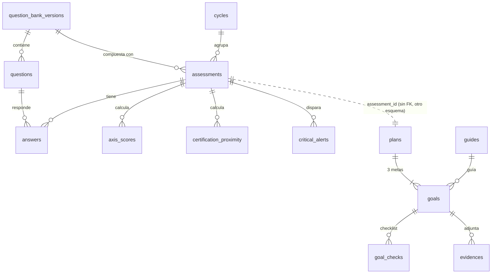
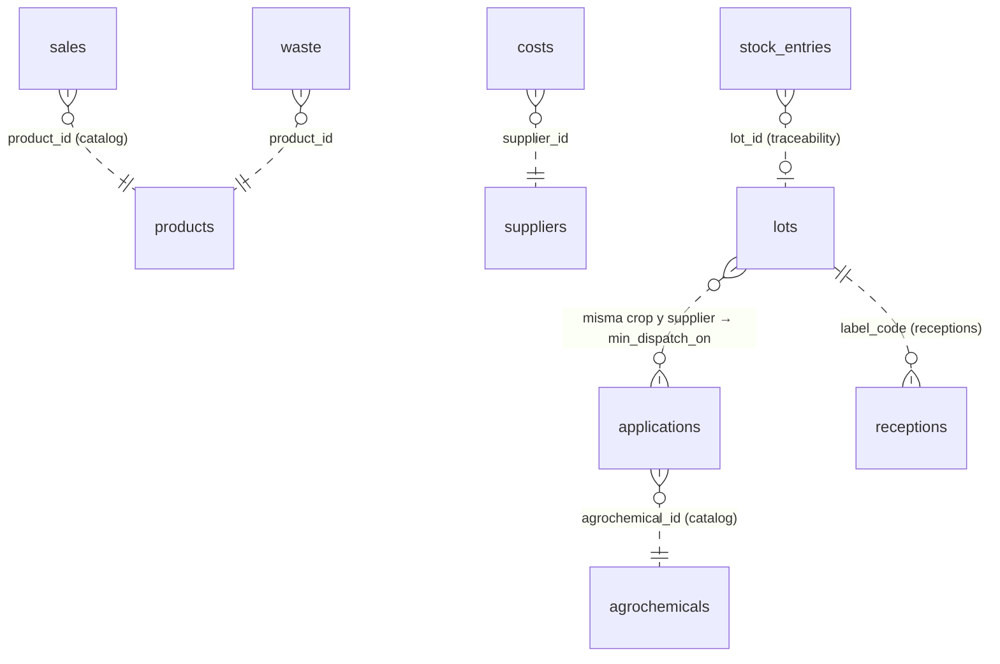
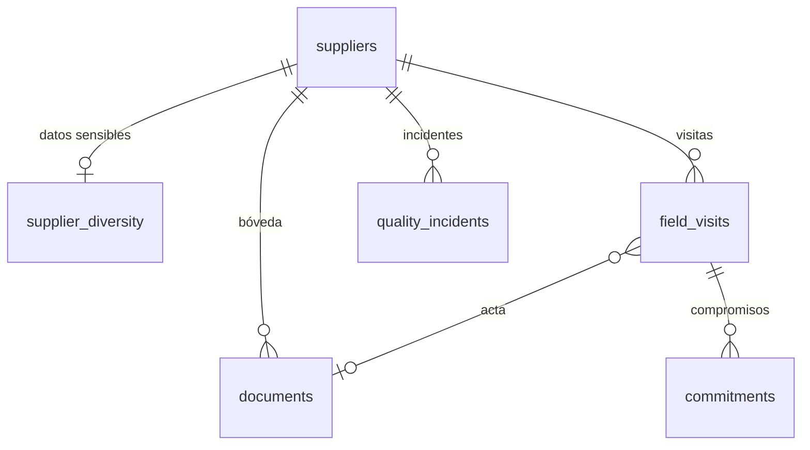
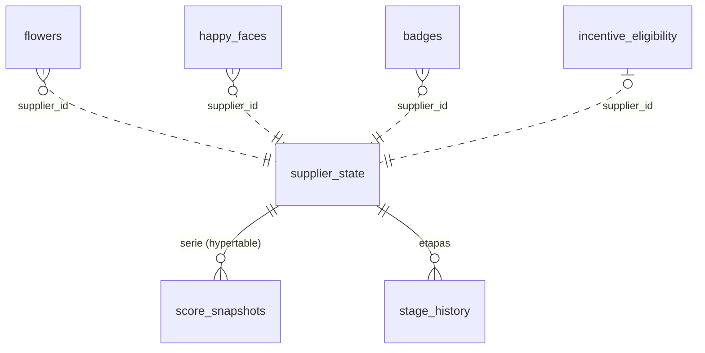

# Modelo de datos

**Versión 1.0 · 15 de octubre de 2026.** Modelo lógico del servidor (PostgreSQL 16 + TimescaleDB) y del cliente (WatermelonDB). Deriva de [`requerimientos.md`](requerimientos.md), [`arquitectura.md`](arquitectura.md) §3.3 y §5, [ADR-0002](../adr/ADR-0002-monolito-modular.md), [ADR-0005](../adr/ADR-0005-local-first-watermelondb.md), [ADR-0006](../adr/ADR-0006-cifrado-local-y-sesion-offline.md) y [ADR-0007](../adr/ADR-0007-tareas-asincronas-outbox.md).

> Estado de implementación: la migración `0001` (backend) crea los 17 esquemas, `shared.outbox`, `shared.audit_log` y `sync.processed_mutations`. El resto de tablas se crea con la migración del módulo en el release indicado en cada sección.

---

## 1. Convenciones (RNF-DATA-001)

| Regla | Detalle |
|---|---|
| Un esquema por módulo | `iam`, `privacy`, `suppliers`, `catalog`, `assessment`, `improvement`, `erp`, `traceability`, `receptions`, `scoring`, `recognition`, `learning`, `impact`, `reporting`, `notifications`, `sync` + `shared` (técnico). |
| Claves | `id UUID` PK. En tablas sincronizadas el UUID v4 lo genera el cliente y el servidor nunca lo reasigna (RF-SYN-002). |
| Referencias | **FK solo dentro del mismo esquema.** Entre módulos se guarda el UUID (`supplier_id`, `user_id`…) **sin FK** y se valida en la capa de aplicación vía `public.py` (ADR-0002). Nunca JOIN entre esquemas de módulos. |
| Dinero | `BIGINT` en pesos COP enteros, columnas con sufijo `_cop`. |
| Cantidades | `NUMERIC(12,3)` + `unit` original + `base_qty NUMERIC(12,3)` normalizada a la unidad base del producto (RF-ERP-008). |
| Tiempo | Instantes `TIMESTAMPTZ` en UTC (`created_at`, `updated_at`). Fechas de negocio `DATE` locales (`occurred_on`, zona `America/Bogota`). |
| Sincronización | Tablas sincronizadas llevan `server_updated_at TIMESTAMPTZ NOT NULL` (indexado, lo usa `sync/pull`), `deleted_at TIMESTAMPTZ NULL` (borrado lógico) y `mutation_id UUID` del último push. |
| Enumeraciones | `TEXT` + `CHECK` (no tipos `ENUM` de PostgreSQL, para migrar sin bloqueos). |
| Datos sensibles | Columnas marcadas 🔒 se cifran en reposo (RNF-SEC-008, `pgcrypto` / cifrado de aplicación) y nunca se escriben en logs (RNF-OBS-001). |
| Nombres | `snake_case`; índices `ix_<tabla>_<col>`; restricciones según `NAMING_CONVENTION` de `shared/infrastructure/db.py`. |

## 2. Hypertables de TimescaleDB

| Tabla | Columna de tiempo | Motivo | Retención |
|---|---|---|---|
| `scoring.score_snapshots` | `computed_at` | Serie diaria provisional + cierre oficial por ciclo (RF-SCO-001, 004) | Indefinida (comprimir > 90 días) |
| `reporting.supplier_metrics_daily` | `day` | Agregados diarios por proveedor para dashboards (RF-RPT-001…004) sin leer filas del ERP (RF-PRV-007) | Indefinida (comprimir > 30 días) |
| `shared.audit_log` | `created_at` | Candidata en R6 si supera 1 M filas (hoy tabla normal; requiere PK `(id, created_at)`) | 2 años (RNF-SEC-007) |

Las tablas del ERP **no** son hypertables: el volumen por proveedor es bajo (≤ ~50 registros/semana × 450) y su PK debe ser el UUID del cliente.

---

## 3. Servidor por esquema

### 3.1 `shared` (técnico) — R0 ✅

| Tabla | Columnas | Índices / notas |
|---|---|---|
| `outbox` | `id UUID PK` (= `event_id`), `event_name VARCHAR(120)`, `payload JSONB`, `occurred_at TIMESTAMPTZ`, `created_at TIMESTAMPTZ DEFAULT now()`, `processed_at TIMESTAMPTZ NULL`, `attempts INT DEFAULT 0`, `last_error TEXT`, `dead BOOL DEFAULT false` | `ix_outbox_event_name`; parcial `ix_outbox_pending (created_at) WHERE processed_at IS NULL AND NOT dead`. ADR-0007. |
| `audit_log` | `id BIGINT IDENTITY PK`, `actor_id UUID`, `actor_role VARCHAR(16)`, `action VARCHAR(80)`, `resource_type VARCHAR(60)`, `resource_id VARCHAR(64)`, `details JSONB`, `ip INET`, `created_at TIMESTAMPTZ` | `(actor_id, created_at)`. RNF-SEC-007. |
| `alembic_version` | — | Versión de migraciones. |

### 3.2 `iam` — R1

| Tabla | Columnas | Índices / notas |
|---|---|---|
| `users` | `id UUID PK`, `full_name TEXT`, `phone VARCHAR(10) NULL` (`CHECK ^3\d{9}$`), `email CITEXT NULL`, `password_hash TEXT` (Argon2id, RNF-SEC-002), `role TEXT CHECK IN ('PROVEEDOR','REVIEWER','ADMIN')`, `is_active BOOL`, `failed_attempts SMALLINT`, `locked_until TIMESTAMPTZ NULL`, `assisted_by UUID NULL` (RF-IAM-008), `created_at`, `updated_at` | `UNIQUE(phone)`, `UNIQUE(email)`, `CHECK (phone IS NOT NULL OR email IS NOT NULL)`. RF-IAM-001, 005, 006. |
| `refresh_tokens` | `id UUID PK`, `user_id UUID FK users`, `family_id UUID`, `token_hash BYTEA`, `issued_at`, `expires_at`, `revoked_at NULL`, `replaced_by UUID NULL`, `device_label TEXT` | `(user_id)`, `(family_id)`; rotación con detección de reutilización (RNF-SEC-003). |
| `password_resets` | `id UUID PK`, `user_id UUID FK`, `code_hash BYTEA`, `channel TEXT CHECK IN ('email','assisted')`, `created_by UUID NULL`, `expires_at`, `used_at NULL` | RF-IAM-007. |

### 3.3 `privacy` — R1

| Tabla | Columnas | Índices / notas |
|---|---|---|
| `consent_texts` | `id UUID PK`, `kind TEXT CHECK IN ('general','sensitive','declaration')`, `version INT`, `body_md TEXT`, `sha256 CHAR(64)`, `published_at` | `UNIQUE(kind, version)`. |
| `consents` 🔄 | `id UUID PK`, `user_id UUID`, `consent_text_id UUID FK`, `decision TEXT CHECK IN ('granted','denied','revoked')`, `method TEXT CHECK IN ('checkbox','signature')`, `device_at TIMESTAMPTZ`, `server_at TIMESTAMPTZ`, `signature_svg TEXT NULL` 🔒, + columnas de sync | **Append-only** (RF-PRV-003): revocar inserta una fila nueva. `(user_id, server_at)`. |
| `declarations` 🔄 | `id UUID PK`, `user_id UUID`, `assessment_id UUID`, `consent_text_id UUID FK`, `signer_name TEXT`, `signature_svg TEXT NULL` 🔒, `device_at`, `server_at`, + sync | RF-PRV-004. `UNIQUE(assessment_id)`. |
| `data_requests` | `id UUID PK`, `user_id UUID`, `kind TEXT CHECK IN ('access','deletion','revocation')`, `status TEXT CHECK IN ('RECIBIDA','EN_TRAMITE','RESUELTA')`, `due_on DATE` (15 días hábiles), `resolved_by UUID NULL`, `notes TEXT`, `created_at`, `resolved_at` | RF-PRV-005, 006. `(status, due_on)`. |

### 3.4 `suppliers` — R1 (ficha) · R3 (expediente)

| Tabla | Columnas | Índices / notas |
|---|---|---|
| `suppliers` 🔄 | `id UUID PK`, `owner_user_id UUID` (iam), `person_type TEXT CHECK IN ('natural','juridica')`, `tax_id VARCHAR(15)`, `tax_dv CHAR(1)`, `legal_name TEXT`, `legal_rep TEXT NULL`, `department_code CHAR(2)`, `municipality_code CHAR(5)` (DIVIPOLA), `vereda TEXT NULL`, `latitude NUMERIC(9,6) NULL`, `longitude NUMERIC(9,6) NULL` (sin `float` en dominio), `contact_channel TEXT CHECK IN ('whatsapp','llamada','correo')`, `main_category TEXT`, `secondary_categories TEXT[]`, `size TEXT CHECK IN ('micro','pequena','mediana','grande')`, `origin TEXT CHECK IN ('nacional','nacional_importados','filial_extranjera')`, `has_sustainability_report BOOL`, `segment TEXT CHECK IN ('ESTRATEGICO','LOCAL') DEFAULT 'LOCAL'`, `profile_completed_at NULL` (columnas de la ficha nulas hasta completarla; CHECK de campos obligatorios al completar), + sync | `UNIQUE(tax_id)`, `UNIQUE(owner_user_id)`, `(main_category)`, `(segment)`, `(municipality_code)`. DV validado módulo 11 en dominio. RF-SUP-001…004. |
| `supplier_diversity` 🔄 | `supplier_id UUID PK FK`, `women_led TEXT CHECK IN ('si','no','pnr')` 🔒, `diverse_led TEXT` 🔒, `diverse_employment TEXT` 🔒, `consent_id UUID` (privacy), + sync | Separada para aislar datos sensibles (RF-PRV-002). |
| `documents` | `id UUID PK`, `supplier_id UUID FK`, `doc_type TEXT CHECK IN ('rut','camara_comercio','ica','icontec','iso14001','bcorp','globalgap','contrato','ficha_tecnica','acta','otro')`, `object_key TEXT`, `mime TEXT`, `size_bytes INT CHECK ≤ 10485760`, `sha256 CHAR(64)`, `issued_on DATE`, `expires_on DATE NULL`, `review_status TEXT CHECK IN ('PENDIENTE','VERIFICADO','RECHAZADO')`, `review_reason TEXT`, `reviewed_by UUID NULL`, `uploaded_by UUID`, `created_at` | `(supplier_id, doc_type)`, `(expires_on) WHERE review_status='VERIFICADO'`. Estado de vigencia calculado (RF-SUP-005, 006). |
| `field_visits` | `id UUID PK`, `supplier_id UUID FK`, `visited_on DATE`, `kind TEXT CHECK IN ('auditoria','capacitacion','seguimiento')`, `ally TEXT CHECK IN ('SENA','Asohofrucol','CampoLimpio','RAVC','otro')`, `findings TEXT`, `minutes_document_id UUID NULL FK documents`, `reviewer_id UUID`, `created_at` | `(supplier_id, visited_on DESC)`. RF-SUP-007. |
| `commitments` | `id UUID PK`, `visit_id UUID FK field_visits`, `action TEXT`, `owner TEXT`, `due_on DATE`, `closing_evidence TEXT`, `closed_at NULL` | DOC-MATRIZ §16. |
| `quality_incidents` | `id UUID PK`, `supplier_id UUID FK`, `occurred_on DATE`, `reception_id UUID NULL` (receptions), `lot_code TEXT NULL`, `kind TEXT`, `severity TEXT CHECK IN ('baja','media','alta')`, `description TEXT`, `reviewer_id UUID`, `created_at` | RF-SUP-008. |

### 3.5 `catalog` — R1 · R2 · R3

| Tabla | Columnas | Índices / notas |
|---|---|---|
| `categories` | `code TEXT PK` (`fruver`, `lacteos`, `carnes`, `pescados_mariscos`, `insumos_servicios`), `name TEXT`, `status TEXT CHECK IN ('ACTIVA','PROXIMAMENTE')`, `icon TEXT`, `position SMALLINT` | RF-CAT-001, C-08. Datos de referencia en la migración `catalog_0003`. |
| `axes` | `id UUID PK`, `category_code TEXT FK`, `code TEXT`, `name TEXT`, `short_name TEXT`, `icon TEXT`, `position SMALLINT` | `UNIQUE(category_code, code)`. Fruver: `bpa`, `residuos`, `carbono`, `infantil`, `ddhh` (RF-CAT-002). |
| `products` | `id UUID PK`, `category_code TEXT FK`, `name TEXT`, `base_unit TEXT CHECK IN ('kg','litro','unidad')`, `min_price_per_base_cop BIGINT NULL`, `max_price_per_base_cop BIGINT NULL`, `active BOOL` | RF-CAT-003, S-11. |
| `unit_conversions` | `id UUID PK`, `product_id UUID NULL FK` (NULL = global), `unit TEXT`, `factor_to_base NUMERIC(12,4)` | Global: arroba = 12,5 kg, bulto = 50 kg (S-12). `UNIQUE(product_id, unit)`. |
| `agrochemicals` | `id UUID PK`, `trade_name TEXT`, `ica_registry TEXT`, `active_ingredient TEXT`, `active BOOL` | `UNIQUE(ica_registry)`. RF-CAT-005. |
| `withdrawal_periods` | `id UUID PK`, `agrochemical_id UUID FK`, `crop TEXT`, `days SMALLINT CHECK > 0`, `source TEXT` | `UNIQUE(agrochemical_id, crop)`. Q-03. |
| `parameter_sets` | `id UUID PK`, `key TEXT` (`scoring.weights`, `assessment.levels`, `impact.emission_factors`, `scoring.p2_formula`, `scoring.p3_formula`, `recognition.thresholds`, `impact.monetization`…), `version INT`, `value JSONB`, `valid_from TIMESTAMPTZ`, `published_by UUID NULL` (NULL = versión inicial de sistema), `published_at` | `UNIQUE(key, version)`, `(key, valid_from DESC)`. Inmutables tras publicar (RF-CAT-004). |
| `divipola` | `municipality_code CHAR(5) PK`, `department_code CHAR(2)`, `department TEXT`, `municipality TEXT` | Carga inicial DANE. |
| `support_directory` | `id UUID PK`, `label TEXT`, `channel TEXT CHECK IN ('whatsapp','llamada','correo')`, `value TEXT`, `position SMALLINT` | RF-NOT-002. |

### 3.6 `assessment` — R1

| Tabla | Columnas | Índices / notas |
|---|---|---|
| `question_bank_versions` | `id UUID PK`, `category_code TEXT`, `version INT`, `status TEXT CHECK IN ('BORRADOR','PUBLICADA','RETIRADA')`, `published_at`, `published_by UUID` | `UNIQUE(category_code, version)`. RF-ASM-011. |
| `questions` | `id UUID PK`, `bank_version_id UUID FK`, `code TEXT`, `axis_code TEXT`, `text TEXT`, `help TEXT`, `answer_type TEXT CHECK IN ('sino','sino_na','single','multi','number')`, `options JSONB NULL`, `weight SMALLINT CHECK 1..5`, `priority SMALLINT`, `sizes TEXT[]`, `person_types TEXT[]`, `is_sensitive BOOL`, `critical_when TEXT[] NULL`, `critical_message TEXT NULL`, `frameworks JSONB` (`{"bcorp":…, "iso_gri":…, "tcfd_sasb":…, "co":…}`), `certifications TEXT[]` (`bpa_ica`, `bcorp`, `globalgap`, `iso14001`) | `UNIQUE(bank_version_id, code)`, `(bank_version_id, axis_code, priority)`. RF-ASM-002, 009. |
| `cycles` | `id UUID PK`, `year SMALLINT`, `term SMALLINT CHECK 1..3`, `starts_on DATE`, `ends_on DATE`, `closed_at NULL` | `UNIQUE(year, term)`. C1 ene–abr, C2 may–ago, C3 sep–dic (RF-ASM-004). |
| `assessments` 🔄 | `id UUID PK`, `supplier_id UUID`, `cycle_id UUID FK`, `bank_version_id UUID FK`, `composed_question_ids UUID[]`, `status TEXT CHECK IN ('EN_CURSO','ENVIADA')`, `current_index SMALLINT`, `submitted_at NULL`, `pillar1 NUMERIC(5,2) NULL`, `bpa_ica_proximity NUMERIC(5,2) NULL`, `rules_version INT`, + sync | `UNIQUE(supplier_id, cycle_id)`; inmutable tras `ENVIADA`. RF-ASM-001, 003, 004, 008. |
| `answers` 🔄 | `id UUID PK`, `assessment_id UUID FK`, `question_id UUID FK`, `value TEXT` (`si`/`aveces`/`no`/`na`/`pnr` o código de opción), `number_value NUMERIC NULL`, `answered_at TIMESTAMPTZ`, + sync | `UNIQUE(assessment_id, question_id)`. Respuestas sensibles 🔒. |
| `axis_scores` | `assessment_id UUID FK`, `axis_code TEXT`, `score NUMERIC(5,2) NULL`, `level TEXT NULL`, `urgent BOOL`, PK `(assessment_id, axis_code)` | Calculado en servidor con `domain/scoring.py` (RF-ASM-005…007). |
| `certification_proximity` | `assessment_id UUID FK`, `certification TEXT`, `percent NUMERIC(5,2)`, PK `(assessment_id, certification)` | RF-ASM-009. |
| `critical_alerts` | `id UUID PK`, `assessment_id UUID FK`, `supplier_id UUID`, `question_id UUID`, `axis_code TEXT`, `message TEXT`, `status TEXT CHECK IN ('ABIERTA','EN_SEGUIMIENTO','CERRADA')`, `handled_by UUID NULL`, `created_at` | `(status, created_at)`. RF-ASM-007, RF-NOT-004. |

### 3.7 `improvement` — R1

| Tabla | Columnas | Índices / notas |
|---|---|---|
| `guides` | `id UUID PK`, `category_code TEXT`, `axis_code TEXT`, `slug TEXT`, `title TEXT`, `intro_md TEXT`, `steps JSONB`, `checklist JSONB` (lista de ítems con `id`), `tip TEXT`, `source TEXT`, `minutes SMALLINT`, `is_bonus BOOL`, `calculator TEXT NULL` (`carbon`), `version INT`, `published_at` | `UNIQUE(slug, version)`. RF-IMP-003, 006. |
| `plans` 🔄 | `id UUID PK`, `supplier_id UUID`, `assessment_id UUID` (assessment), `cycle_id UUID`, `generated_at`, `completed_at NULL`, `rules_version INT`, + sync | `UNIQUE(assessment_id)`. RF-IMP-001. |
| `goals` 🔄 | `id UUID PK`, `plan_id UUID FK`, `position SMALLINT CHECK 1..3`, `axis_code TEXT`, `priority TEXT CHECK IN ('urgente','alta','media','mantener')`, `finding TEXT`, `action TEXT`, `owner TEXT`, `due_on DATE`, `expected_evidence TEXT`, `guide_id UUID FK`, `status TEXT CHECK IN ('ABIERTA','COMPLETADA','VALIDADA','REABIERTA')`, `reviewer_comment TEXT NULL`, `validated_by UUID NULL`, + sync | `UNIQUE(plan_id, position)`. RF-IMP-002, 004, 005. |
| `goal_checks` 🔄 | `id UUID PK`, `goal_id UUID FK`, `item_id TEXT`, `checked BOOL`, `checked_at`, + sync | `UNIQUE(goal_id, item_id)`. Última escritura gana (RF-SYN-005). |
| `evidences` 🔄 | `id UUID PK`, `goal_id UUID FK`, `object_key TEXT NULL` (se llena al subir en P3), `mime TEXT`, `size_bytes INT CHECK ≤ 1048576`, `captured_at`, + sync | RF-IMP-004. |

### 3.8 `erp` — R2 (append-only, RF-SYN-005)

| Tabla | Columnas | Índices / notas |
|---|---|---|
| `sales` 🔄 | `id UUID PK`, `supplier_id UUID`, `occurred_on DATE`, `customer_kind TEXT CHECK IN ('smile','otro')`, `customer_name TEXT NULL`, `product_id UUID` (catalog), `product_other TEXT NULL`, `qty NUMERIC(12,3)`, `unit TEXT`, `base_qty NUMERIC(12,3)`, `total_cop BIGINT CHECK ≥ 0` 🔒, `out_of_range_ack BOOL`, `voided_at NULL`, `void_reason TEXT NULL`, + sync | `(supplier_id, occurred_on)`. RF-ERP-001, 007, 008, 009. |
| `costs` 🔄 | `id UUID PK`, `supplier_id UUID`, `occurred_on DATE`, `category TEXT CHECK IN ('insumos_semillas','fertilizantes_agroquimicos','mano_obra_jornales','fletes_combustible_mantenimiento')`, `amount_cop BIGINT CHECK ≥ 0` 🔒, `description TEXT NULL`, `is_bpa_investment BOOL DEFAULT false`, `voided_at`, `void_reason`, + sync | `(supplier_id, occurred_on)`, `(supplier_id, category)`. RF-ERP-002, RF-CAL-003. |
| `stock_entries` 🔄 | `id UUID PK`, `supplier_id UUID`, `occurred_on DATE`, `source TEXT CHECK IN ('cosecha','compra')`, `product_id UUID`, `qty`, `unit`, `base_qty`, `lot_id UUID NULL` (traceability), `voided_at`, + sync | `(supplier_id, product_id, occurred_on)`. RF-ERP-003. |
| `waste` 🔄 | `id UUID PK`, `supplier_id UUID`, `occurred_on DATE`, `product_id UUID`, `qty`, `unit`, `base_qty`, `cause TEXT CHECK IN ('plagas_enfermedades','dano_mecanico_postcosecha','descomposicion_natural','defecto_empaque')`, `voided_at`, + sync | `(supplier_id, occurred_on)`. RF-ERP-006, C-06. |
| `stock_balances` (vista) | `supplier_id`, `product_id`, `base_unit`, `available_base_qty` = Σ entradas − Σ ventas − Σ mermas (no anuladas) | Vista del esquema `erp`; RF-ERP-004. |

**Acceso interno:** ningún endpoint para `REVIEWER`/`ADMIN` lee estas tablas; `erp` publica `ErpEntryRecorded`/`WasteRecorded` con **solo agregados** y `reporting` los acumula (RF-PRV-007).

### 3.9 `traceability` — R2

| Tabla | Columnas | Índices / notas |
|---|---|---|
| `applications` 🔄 | `id UUID PK`, `supplier_id UUID`, `applied_on DATE`, `agrochemical_id UUID` (catalog), `crop TEXT`, `plot TEXT NULL`, `dose TEXT`, `withdrawal_days SMALLINT` (copiado del catálogo al registrar), + sync | `(supplier_id, crop, applied_on DESC)`. RF-TRZ-001. |
| `lots` 🔄 | `id UUID PK`, `supplier_id UUID`, `crop TEXT`, `product_id UUID`, `qty`, `unit`, `base_qty`, `planned_harvest_on DATE`, `min_dispatch_on DATE` (máx(aplicación + carencia)), `status TEXT CHECK IN ('BLOQUEADO','LISTO','LIBERADO')`, `no_application_declared BOOL`, `released_on DATE NULL`, `label_code VARCHAR(40) NULL`, `device_suffix VARCHAR(4)`, + sync | `UNIQUE(label_code)`, `(supplier_id, status)`. `CHECK (released_on IS NULL OR released_on >= min_dispatch_on)` (RF-TRZ-003, 007). Código S-16 (RF-TRZ-004). |

### 3.10 `receptions` — R3

| Tabla | Columnas | Índices / notas |
|---|---|---|
| `receptions` | `id UUID PK`, `supplier_id UUID`, `scheduled_at TIMESTAMPTZ`, `received_at TIMESTAMPTZ`, `label_code TEXT NULL`, `label_valid BOOL`, `product_id UUID`, `agreed_kg NUMERIC(12,3)`, `received_kg NUMERIC(12,3)`, `rejected_kg NUMERIC(12,3) CHECK ≤ received_kg`, `rejection_cause TEXT NULL`, `recorded_by UUID`, `import_batch_id UUID NULL FK`, `created_at` | `(supplier_id, received_at)`, `(label_code)`. RF-REC-001, 005. |
| `import_batches` | `id UUID PK`, `file_object_key TEXT`, `rows_total INT`, `rows_ok INT`, `errors JSONB`, `created_by UUID`, `created_at` | RF-REC-002. |

### 3.11 `scoring` — R3

| Tabla | Columnas | Índices / notas |
|---|---|---|
| `score_snapshots` ⏱ | `supplier_id UUID`, `computed_at TIMESTAMPTZ`, `cycle_id UUID`, `kind TEXT CHECK IN ('provisional','oficial')`, `p1 NUMERIC(5,2) NULL`, `p2 NUMERIC(5,2) NULL`, `p3 NUMERIC(5,2) NULL`, `total NUMERIC(5,2)`, `partial BOOL` (S-07), `params_version INT`, PK `(supplier_id, computed_at)` | **Hypertable** por `computed_at`. RF-SCO-001, 002, 004. |
| `stage_history` | `id UUID PK`, `supplier_id UUID`, `stage SMALLINT CHECK 1..6`, `entered_at`, `left_at NULL`, `reason TEXT CHECK IN ('auto','override','e6_asignada','e6_retirada')`, `actor_id UUID NULL`, `note TEXT NULL` | `(supplier_id, entered_at DESC)`; parcial `UNIQUE(supplier_id) WHERE left_at IS NULL`. RF-SCO-003, 005. |
| `supplier_state` | `supplier_id UUID PK`, `current_stage SMALLINT`, `last_total NUMERIC(5,2)`, `segment TEXT`, `category_code TEXT`, `updated_at` | Proyección local alimentada por eventos (perfil, diagnóstico, ERP agregado, aprendizaje). |

### 3.12 `recognition` — R4

| Tabla | Columnas | Índices / notas |
|---|---|---|
| `flowers` | `id UUID PK`, `supplier_id UUID`, `source TEXT CHECK IN ('auto_merma','auto_erp','manual')`, `reason TEXT`, `granted_by UUID NULL`, `granted_at`, `revoked_at NULL`, `revoked_by UUID NULL`, `revoke_reason TEXT NULL` | `(supplier_id) WHERE revoked_at IS NULL`. RF-GAM-001. |
| `happy_faces` | `id UUID PK`, `supplier_id UUID`, `trigger TEXT CHECK IN ('erp_4_semanas','merma_mes','plan_100','documento_a_tiempo','compostaje')`, `period_key TEXT`, `created_at`, `seen_at NULL` | `UNIQUE(supplier_id, trigger, period_key)` (idempotencia). RF-GAM-002. |
| `badges` | `id UUID PK`, `supplier_id UUID`, `badge TEXT CHECK IN ('maestro_bpa','pesca_responsable')`, `awarded_at`, `revoked_at NULL` | `UNIQUE(supplier_id, badge) WHERE revoked_at IS NULL`. RF-GAM-003. |
| `incentive_eligibility` | `supplier_id UUID PK`, `eligible BOOL`, `rule_version INT`, `missing JSONB`, `evaluated_at` | RF-GAM-004 (regla Q-01). |

### 3.13 `learning` — R4

| Tabla | Columnas | Índices / notas |
|---|---|---|
| `contents` | `id UUID PK`, `kind TEXT CHECK IN ('clip','ficha')`, `title TEXT`, `category_code TEXT`, `axis_code TEXT NULL`, `path TEXT CHECK IN ('rural','corporativo','ambos')`, `object_key TEXT`, `mime TEXT`, `size_bytes INT`, `duration_s SMALLINT NULL CHECK ≤ 120`, `published_at NULL` | `CHECK (kind <> 'clip' OR (mime = 'video/mp4' AND size_bytes <= 4194304))`. RF-LRN-001, 005. |
| `assignments` 🔄 | `id UUID PK`, `supplier_id UUID`, `content_id UUID FK`, `goal_id UUID NULL` (improvement), `assigned_at`, + sync | `UNIQUE(supplier_id, content_id)`. RF-LRN-002. |
| `progress` 🔄 | `id UUID PK`, `supplier_id UUID`, `content_id UUID FK`, `max_position_s SMALLINT`, `completed_at NULL`, + sync | `UNIQUE(supplier_id, content_id)`. Completo ≥ 90 % (S-15). |

### 3.14 `impact` — R1 (huella) · R5

| Tabla | Columnas | Índices / notas |
|---|---|---|
| `carbon_estimates` 🔄 | `id UUID PK`, `supplier_id UUID`, `cycle_id UUID`, `diesel_gal NUMERIC(10,2)`, `gasoline_gal NUMERIC(10,2)`, `synthetic_n_kg NUMERIC(10,2)`, `grid_kwh NUMERIC(10,2)`, `kg_co2e NUMERIC(12,2)`, `factors_version INT`, + sync | RF-CAL-001, 002. Fórmula de DOC-FRUVER, factores en `catalog.parameter_sets`. |
| `roi_runs` | `id UUID PK`, `supplier_id UUID`, `cycle_id UUID`, `inputs JSONB`, `roi_percent NUMERIC(8,2)`, `params_version INT`, `computed_at` | RF-CAL-003. |
| `sroi_runs` | `id UUID PK`, `scope TEXT CHECK IN ('supplier','network')`, `supplier_id UUID NULL`, `cycle_id UUID`, `inputs JSONB`, `sroi NUMERIC(8,2)`, `params_version INT`, `computed_at` | RF-CAL-004. |

### 3.15 `reporting` — R3 · R5 (solo proyecciones agregadas)

| Tabla | Columnas | Índices / notas |
|---|---|---|
| `supplier_metrics_daily` ⏱ | `supplier_id UUID`, `day DATE`, `sales_total_cop BIGINT`, `costs_total_cop BIGINT`, `margin_pct NUMERIC(6,2)`, `waste_pct NUMERIC(6,2)`, `erp_entries INT`, `received_kg`, `rejected_kg`, `lots_released INT`, `lots_with_valid_label INT`, PK `(supplier_id, day)` | **Hypertable** por `day`. Solo agregados (RF-PRV-007, RF-RPT-006). |
| `supplier_directory` | `supplier_id UUID PK`, `legal_name TEXT`, `category_code TEXT`, `segment TEXT`, `municipality_code CHAR(5)`, `stage SMALLINT`, `total_score NUMERIC(5,2)`, `annual_volume_kg NUMERIC(14,3)`, `child_labour_alert BOOL`, `updated_at` | Base del visor de riesgo y del Pareto (RF-RPT-001, 002, 004). |
| `framework_compliance` | `supplier_id UUID`, `cycle_id UUID`, `framework TEXT`, `percent NUMERIC(5,2)`, PK `(supplier_id, cycle_id, framework)` | Consola ESG (RF-RPT-004). |
| `exports` | `id UUID PK`, `kind TEXT CHECK IN ('huella','ddhh','valor_compartido')`, `format TEXT CHECK IN ('pdf','xlsx')`, `filters JSONB`, `status TEXT CHECK IN ('EN_COLA','GENERANDO','LISTO','ERROR')`, `object_key TEXT NULL`, `requested_by UUID`, `requested_at`, `finished_at NULL` | RF-RPT-005. |

### 3.16 `notifications` — R1 · R3

| Tabla | Columnas | Índices / notas |
|---|---|---|
| `threads` 🔄 | `id UUID PK`, `supplier_id UUID`, `kind TEXT CHECK IN ('soporte','recordatorio','asistencia_tecnica')`, `subject TEXT`, `created_by UUID`, `created_at`, + sync | `(supplier_id, created_at DESC)`. RF-NOT-001. |
| `messages` 🔄 | `id UUID PK`, `thread_id UUID FK`, `author_id UUID`, `body VARCHAR(500)`, `sent_at`, `read_at NULL`, + sync | `(thread_id, sent_at)`. |
| `internal_alerts` | `id UUID PK`, `kind TEXT CHECK IN ('critica','documento_por_vencer','privacidad')`, `supplier_id UUID NULL`, `ref_id UUID`, `payload JSONB`, `created_at`, `acknowledged_by UUID NULL`, `acknowledged_at NULL` | `(acknowledged_at NULLS FIRST, created_at)`. RF-NOT-004. |
| `push_subscriptions` | `id UUID PK`, `user_id UUID`, `endpoint TEXT`, `keys JSONB`, `created_at` | RF-NOT-003 (Could). |

### 3.17 `sync` — R0 ✅

| Tabla | Columnas | Índices / notas |
|---|---|---|
| `processed_mutations` | `mutation_id UUID PK`, `user_id UUID`, `priority SMALLINT CHECK IN (1,2,3)`, `processed_at TIMESTAMPTZ`, `result JSONB` (`accepted`, `rejected`) | `(user_id, processed_at)`. Idempotencia de `POST /sync/push` (RF-SYN-002). |

🔄 = tabla sincronizada con WatermelonDB (lleva `server_updated_at`, `deleted_at`, `mutation_id`). ⏱ = hypertable. 🔒 = sensible/cifrada.

---

## 4. ERD de los módulos principales

### 4.1 `assessment` + `improvement`

### 4.2 `erp` + `traceability`

### 4.3 `suppliers`

### 4.4 `scoring` + `recognition`

Las líneas punteadas son referencias por UUID sin FK (cruzan esquemas).

---

## 5. Base local del cliente (WatermelonDB)

Adaptador LokiJS sobre IndexedDB (ADR-0005). Cada tabla incluye las columnas implícitas de WatermelonDB (`id`, `_status`, `_changed`) y `server_updated_at`. Los nombres coinciden con `arquitectura.md` §5; el servidor enruta cada tabla a su módulo.

| Tabla local | Origen servidor | Dirección | Prioridad | Columnas | Cifrado (ADR-0006) |
|---|---|---|---|---|---|
| `erp_sales` | `erp.sales` | push | **P1** | `occurred_on`, `customer_kind`, `customer_name`, `product_id`, `product_other`, `qty`, `unit`, `total_cop`, `out_of_range_ack`, `voided_at`, `void_reason` | `total_cop`, `customer_name` |
| `erp_costs` | `erp.costs` | push | **P1** | `occurred_on`, `category`, `amount_cop`, `description`, `is_bpa_investment`, `voided_at`, `void_reason` | `amount_cop`, `description` |
| `erp_stock_entries` | `erp.stock_entries` | push | **P1** | `occurred_on`, `source`, `product_id`, `qty`, `unit`, `lot_id`, `voided_at` | — |
| `erp_waste` | `erp.waste` | push | **P1** | `occurred_on`, `product_id`, `qty`, `unit`, `cause`, `voided_at` | — |
| `trz_applications` | `traceability.applications` | push | **P1** | `applied_on`, `agrochemical_id`, `crop`, `plot`, `dose`, `withdrawal_days` | — |
| `trz_lots` | `traceability.lots` | push/pull | **P1** | `crop`, `product_id`, `qty`, `unit`, `planned_harvest_on`, `min_dispatch_on`, `status`, `no_application_declared`, `released_on`, `label_code`, `device_suffix` | — |
| `assessments` | `assessment.assessments` | push/pull | **P2** | `cycle_id`, `bank_version_id`, `composed_question_ids` (JSON), `status`, `current_index`, `submitted_at`, `pillar1`, `bpa_ica_proximity` | — |
| `assessment_answers` | `assessment.answers` | push | **P2** | `assessment_id`, `question_id`, `value`, `number_value`, `answered_at` | respuestas de preguntas sensibles |
| `declarations` | `privacy.declarations` | push | **P2** | `assessment_id`, `consent_text_id`, `signer_name`, `signature_svg`, `device_at` | `signer_name`, `signature_svg` |
| `consents` | `privacy.consents` | push | **P2** | `consent_text_id`, `decision`, `method`, `device_at`, `signature_svg` | `signature_svg` |
| `supplier_profile` | `suppliers.suppliers` + `supplier_diversity` | push/pull | **P2** | campos de la ficha y la caracterización (§3.4) | `women_led`, `diverse_led`, `diverse_employment`, `tax_id` |
| `plans` | `improvement.plans` | pull (+push local) | **P2** | `assessment_id`, `cycle_id`, `generated_at`, `completed_at`, `rules_version` | — |
| `goals` | `improvement.goals` | push/pull | **P2** | `plan_id`, `position`, `axis_code`, `priority`, `finding`, `action`, `owner`, `due_on`, `guide_id`, `status`, `reviewer_comment` | — |
| `goal_checks` | `improvement.goal_checks` | push/pull | **P2** | `goal_id`, `item_id`, `checked`, `checked_at` | — |
| `carbon_estimates` | `impact.carbon_estimates` | push | **P2** | `cycle_id`, `diesel_gal`, `gasoline_gal`, `synthetic_n_kg`, `grid_kwh`, `kg_co2e`, `factors_version` | — |
| `learning_progress` | `learning.progress` | push/pull | **P2** | `content_id`, `max_position_s`, `completed_at` | — |
| `evidences` | `improvement.evidences` | push (binario directo a storage) | **P3** | `goal_id`, `local_blob_key`, `object_key`, `mime`, `size_bytes`, `captured_at` | blob local cifrado |
| `messages` | `notifications.messages` (+ `threads`) | pull (+push respuestas) | P2 | `thread_id`, `author_id`, `body`, `sent_at`, `read_at` | — |
| `cat_*` (`categories`, `axes`, `products`, `unit_conversions`, `agrochemicals`, `withdrawal_periods`, `parameters`, `support_directory`) | `catalog.*` | pull | — | espejo de lectura | — |
| `questions`, `guides`, `contents`, `assignments` | `assessment` / `improvement` / `learning` | pull | — (medios en P3) | espejo de lectura | — |
| `recognitions` | `recognition.*` (vista unificada) | pull | — | `kind` (`flor`/`carita`/`insignia`), `trigger`, `granted_at`, `revoked_at`, `seen_at` | — |
| `receptions_own` | `receptions.receptions` (solo del proveedor) | pull | — | `received_at`, `product_id`, `received_kg`, `rejected_kg`, `rejection_cause`, `label_valid` | — |

**Reglas de conflicto (RF-SYN-005):** tablas P1 son *append-only* (editar dentro de 7 días = nueva versión del mismo `id`, el servidor valida la ventana S-10); `supplier_profile` y `goal_checks`: última escritura gana por campo según `server_updated_at`; tablas de solo pull: gana el servidor.

**Tamaño esperado por proveedor (2 años):** ~5 000 registros ERP/TRZ, < 2 MB en IndexedDB sin medios; los clips van a Cache Storage (≤ 4 MB c/u).
